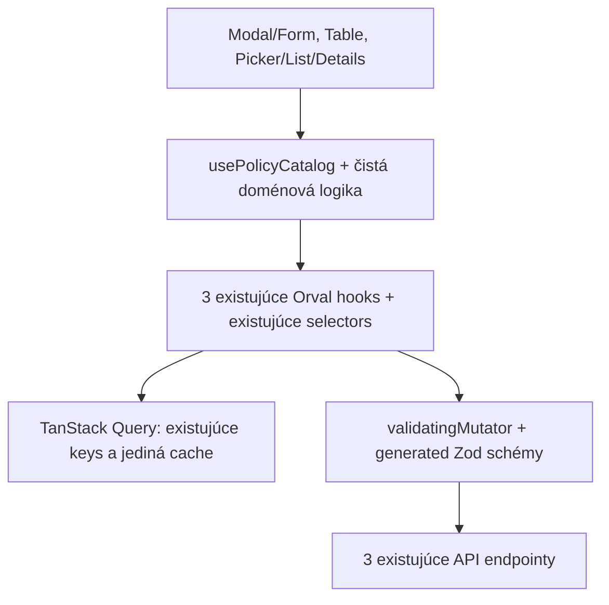

# Implementation Plan – Shared Policy Catalog

Dátum: 2026-10-22. Plán následne schválený používateľovým pokynom `executing-plans inline`; T1–T7 vykonané a overené.
Úlohy a evidencia: [policy-catalog-todo.md](policy-catalog-todo.md). Implementácia prebieha inline na pôvodnej vetve, bez subagentov, worktree, commitu a pushu podľa pokynov používateľa.

## 1. Cieľ a overený východiskový stav

Zjednotiť interpretáciu dostupnosti Snapshot, Recovery Application a Clean Room Policies pre Policy Set modal/form, detail tabuľky a shared picker. Serverové dáta zostanú výhradne v existujúcej TanStack Query cache. Catalog bude vlastniť rozlíšenie stavov, lookup podľa druhu a ID, dostupnosť referencií a adresovanie retry.

Pri začiatku analýzy: vetva `spike/ant-design-shell`, HEAD `9b163f3f`, prázdny `git status --short`, `git diff --stat` aj `git diff --cached --stat`. Nevytvoril sa worktree ani nová vetva. Git hlási neprístupný používateľský ignore súbor; konfigurácia sa nemenila. Pred implementáciou znovu overiť stav, pretože ide o zdieľaný workspace.

Prieskum použil CodeGraph pred vyhľadávaním kódu a aktuálny zdroj na disku. Podklad `architecture-review-recovery-cache-20261021-211912.html`, sekcia Kandidát 1, bol iba hypotézou na overenie. Staršie task dokumenty nie sú záväzným popisom dnešného kontraktu: napríklad `tasks/policy-set-recovery-app-policy-plan.md` ešte uvádza pole `snapshot_policy_ids` a camelCase model, kým aktuálny formulár používa singulárne `snapshot_policy_id` a snake_case.

### Potvrdené zistenia

Závažnosť nižšie opisuje UI/dátovú interpretáciu. Nebola preukázaná strata uložených údajov ani chyba backendu.

| Zistenie | Aktuálny dôkaz | Dôsledok a závažnosť |
| --- | --- | --- |
| 1. Snapshot loading/error splýva s prázdnym výsledkom. | `src/features/recovery-plans/policy-sets/components/PolicySetModal.tsx:55–57,159–167` načíta tri queries, ale snapshot odovzdá iba ako `data ?? []`. `PolicySetForm.tsx:89–109` rozhoduje iba podľa dĺžky zoznamu. | Pri prvom načítaní aj zlyhaní sa zobrazí „no policies“ bez snapshot retry. **Stredná**, nesprávna informácia a chýbajúca možnosť obnovy. |
| 2. Recovery/Clean Room majú loading/error/retry, ale chyba skryje cached options. | `PolicySetForm.tsx:112–145,150–183`: vetvy `isLoading`, potom `error`, až potom zoznam. Modal posiela aj dáta, aj error. | Pri refetch chybe sa existujúce options nevykreslia, hoci query ich zachovala. **Stredná**, zhoršenie editácie počas čiastočného výpadku. |
| 3. Tabuľka nerozlišuje missing a nedostupný zdroj. | `src/features/recovery-plans/policy-sets/components/PolicySetsTable.tsx:95–108` extrahuje iba dáta a používa tri `.find(... )?.name ?? policyId`; detail ich vykreslí na riadkoch 197–199. | Uložené ID sa zachová, ale používateľ nepozná príčinu nerozlíšenej referencie. **Nízka až stredná**. Chyba lookup zdroja sa nesmie zameniť s chybou načítania samotných Policy Sets. |
| 4. Picker agreguje stav rôznych zdrojov. | `src/shared/components/policy-set-picker/PolicySetPicker.tsx:27–42,57–63` tvorí tri mapy a OR loading/error. `PolicySetPickerDetails.tsx:148–158,176–180` odvodzuje jeden loading/incomplete stav pre všetky karty. Retry sa neodovzdáva. | Problém jedného zdroja ovplyvní celkový indikátor, príčina a cielená obnova chýbajú. **Stredná**. Existujúce rozlíšené karty pritom môžu zostať zobrazené; nejde o úplné skrytie detailu. |
| 5. Tri kontajnery už zdieľajú query identitu a cache. | Modal `:55–57`, Table `:95–97`, Picker `:27–29` volajú rovnaké generated hooks s rovnakými selectors, bez vlastných keys. Generated `getGet*QueryOptions` na riadkoch 91–106 používa generated keys a `useGet*` na 141–150 existujúci QueryClient. | **Architektonický invariant, nie chyba**: nový cache/provider ani zjednocujúci endpoint netreba. Viac observerov samo osebe neznamená tri nezávislé cache. |

Ďalšie integračné detaily:

- `PolicySetPickerList.tsx:22–31,55` vyhľadáva podľa názvu/opisu setu a rozlíšeného názvu Recovery policy, pri zobrazení používa fallback ID. Vyhľadávanie dnes nezahŕňa snapshot/clean-room názvy ani ľubovoľné policy ID; rozsah sa nerozšíri.
- `PolicySetPickerDetails.tsx:83–109` používa chýbajúci objekt na označenie celej karty za unavailable. Formátovanie frekvencie, retencie, ikon a prekladov je prezentačná logika a zostane v UI.
- `PolicySetModal.tsx:64–73,99–128` spravuje dirty guard, edit prefill, povinné polia a presný submit payload. Dnešná validácia nekontroluje členstvo ID v aktuálnom zozname; tento plán také pravidlo nepridáva.
- `src/shared/query/cachePolicy.ts:1–13`: staleTime 15 minút, gcTime 60 minút, retry 1, refetch pri focus/mount/reconnect. Nie je tu pravidelný 15-minútový polling. `createAppQueryClient.ts:5–12` používa tieto defaults a existujúcu MutationCache. Catalog časovanie nemení.
- Tri `select*Policies.ts:1–9` zachovávajú generated `*RecordOutput` s defaultmi z validátora. Ide o observer select, nie o inú cache schému; selectors sa zachovajú na pôvodných miestach.
- `orval.config.ts`, `mutationInvalidates`: submit/delete každej policy invaliduje príslušný list; Policy Set mutácie invalidujú `getPolicySets`. Catalog nepridá vlastnú invalidáciu ani `setQueryData`.

| Druh | Generated modul pod `src/generated/query/` | Hook / key factory | Existujúca hodnota key |
| --- | --- | --- | --- |
| Snapshot | `snapshot-policies/snapshot-policies.gen.ts` | `useGetPolicies` / `getGetPoliciesQueryKey` | `['/get_policies']` |
| Recovery Application | `recovery-app-policies/recovery-app-policies.gen.ts` | `useGetRecoveryAppPolicies` / `getGetRecoveryAppPoliciesQueryKey` | `['/get_recovery_app_policies']` |
| Clean Room | `clean-room-policies/clean-room-policies.gen.ts` | `useGetCleanRoomPolicies` / `getGetCleanRoomPoliciesQueryKey` | `['/get_clean_room_policies']` |

Tabuľka dokumentuje existujúce hodnoty, nie návod na ich ručné kopírovanie. Testy i produkčný adaptér sa opierajú o generated factories/hooks.

### Rozhodujúca architektúra

[ADR 0002](../docs/adr/0002-generated-react-query-api-layer.md), najmä body 4, 7–9 a 11, je Accepted a nahrádza ADR 0001. Runtime validácia generated schém reálne prebieha v `validatingMutator`; Catalog ju nebude opakovať. Bod 9 umožňuje fasádu so skutočnou logikou. Navrhovaný modul túto podmienku spĺňa normalizáciou a rozlíšením referencií. Nepotrebuje priamy `useQuery/useQueries/useMutation`, preto netreba rozširovať ESLint výnimky ani oslabovať architektonické guards.

## 2. Alternatívy a rozhodnutie

Počty sú odhad konkrétneho rozsahu vrátane testov a lokalizácie; nezapočítavajú tieto dva plánovacie dokumenty.

| Kritérium | A – lokálne opravy | B – spoločný Catalog |
| --- | --- | --- |
| Súbory | Približne 13: 6 UI + 3 component testy + 3 locales + 1 locale test. | **18: 13 rovnakých + 4 súbory modulu/testov + 1 priamy prototype odberateľ zmenených props.** |
| Nová abstrakcia | Žiadny modul, ale rovnaké rozhodovacie vetvy v troch kontajneroch a ich prezentačných deťoch. | Jedna čistá doménová jednotka a jeden React adaptér; žiadny provider, store, registry ani generický query framework. |
| Odstránená duplicita | Malá: opraví sa správanie, zostane skladanie 3 queries, lookupov a pravidiel cache/error. | Z troch miest zmizne skladanie query stavov; z pickeru mapy, z tabuľky tri ad hoc lookupy, z UI interpretácia dostupnosti. |
| Konzistencia | Každá ďalšia oprava musí zachovať rovnakú pravdivostnú tabuľku na viacerých miestach. | Jedna pravdivostná tabuľka vrátane historických referencií. |
| Testovanie | Časť matice treba testovať v každom kontajneri. | Matica v lacných unit testoch, len odlišné UI zodpovednosti v component testoch a malý hook integračný seam. |
| Riziko regresií | Menší počiatočný zásah, vyššie riziko odlišných opráv. | Väčší počiatočný zásah do props/mockov, nižšie riziko následného rozchádzania pravidiel. |
| Údržba | Výhodná, ak by šlo iba o opravu snapshot loadera. | Výhodná pre požadované jednotné missing/unknown/cachedError/retry naprieč tromi existujúcimi konzumentmi. |

**Odporúčanie B.** Nie pre samotné odporúčanie review, ale preto, že aktuálne tri miesta potrebujú rovnaké doménové rozhodnutie o dôveryhodnosti absencie ID. Štyri dodatočné súbory obsahujú túto logiku a jej testy. Samotný hook vracajúci tri query objekty by kritérium nesplnil.

Čistá logika bez spoločného hooku by bola testovateľná, ale v kontajneroch by zostala trojica hookov, selectors a mapovanie retry. Samotný hook bez čistej logiky by zbytočne viazal celú stavovú maticu na React testy. Zvolená kombinácia: **čisté funkcie + jeden `usePolicyCatalog()` adaptér**, jedna verejná doménová zodpovednosť.

## 3. Cieľová architektúra a hranice



Feature-owned umiestnenie: `src/features/recovery-plans/recovery-policies/catalog/`. Shared picker už dnes importuje selectors z tejto feature; netreba presun celého pickeru ani nový shared dátový framework. Modul závisí od generated vrstvy a troch existujúcich selectors, nikdy od UI komponentov.

- **Orval/validátor:** HTTP kontrakty, generated typy, Zod, existujúce fetch/hooks.
- **TanStack Query:** identita, dáta, retry scheduling, deduplikácia, freshness a invalidácia.
- **Catalog:** odvodené stavy zdrojov, ID lookup, referencie, súhrn dostupnosti setu a smerovanie retry.
- **UI:** texty, farby, formulárový draft, interakcie, formátovanie hodnôt a existujúce business pravidlá uloženia.

Žiadna synchronizovaná kópia: `items` je priamo selected query data. Lookup indexy môžu byť lokálne `useMemo` mapy odkazujúce na tie isté objekty; sú odvodené a pri zmene vstupu zaniknú. Bez `useState/useEffect` synchronizácie, module singleton mapy, perzistencie alebo zápisov do cache. Pri troch katalógoch netreba generický plugin systém ani konfigurovateľné query options vo verejnom API.

## 4. Navrhované TypeScript rozhranie

Nasledujúci kontrakt je návrh na implementáciu, nie nový API model. Používa importované generated output typy; nekopíruje polia backendových recordov. Verejná aktivita je zúžená na UI-potrebné booleany; interný TanStack Query `fetchStatus`, `isStale` ani `dataUpdatedAt` sa nepreposielajú ako súčasť doménového kontraktu.

```ts
type PolicyByKind = {
  snapshot: SnapshotPolicyRecordOutput
  recoveryApp: RecoveryAppPolicyRecordOutput
  cleanRoom: CleanRoomPolicyRecordOutput
}
type PolicyKind = keyof PolicyByKind

type CatalogActivity = {
  isFetching: boolean
  isRefreshing: boolean
  isPaused: boolean
}
type CatalogSource<T> = CatalogActivity & (
  | { status: 'loading'; items: undefined; error: null }
  | { status: 'ready'; items: readonly T[]; error: null }
  | { status: 'empty'; items: readonly T[]; error: null }
  | { status: 'error'; items: undefined; error: Error }
  | { status: 'cachedError'; items: readonly T[]; error: Error }
)

type PolicyReference<T> =
  | { status: 'resolved'; id: string; policy: T;
      verification: 'lastSuccess' | 'cachedAfterError' }
  | { status: 'missing'; id: string; verification: 'lastSuccess' }
  | { status: 'notConfigured' }
  | { status: 'unknown'; id: string;
      reason: 'loading' | 'error' | 'cachedError' }

type PolicySetResolution = {
  snapshot: PolicyReference<SnapshotPolicyRecordOutput>
  recoveryApp: PolicyReference<RecoveryAppPolicyRecordOutput>
  cleanRoom: PolicyReference<CleanRoomPolicyRecordOutput>
  summary: 'resolved' | 'loading' | 'incomplete' | 'cachedError'
}
type PolicyCatalog = {
  sources: { [K in PolicyKind]: CatalogSource<PolicyByKind[K]> }
  resolve<K extends PolicyKind>(
    kind: K, id: string | null | undefined,
  ): PolicyReference<PolicyByKind[K]>
  resolvePolicySet(policySet: Pick<PolicySetRecordOutput,
    'snapshot_policy_id' | 'recovery_app_policy_id' | 'clean_room_policy_id'
  >): PolicySetResolution
  retry(kind: PolicyKind): Promise<void>
}
declare function usePolicyCatalog(): PolicyCatalog
```

Čistý `model/policyCatalog.ts` poskytne normalizáciu minimálneho query vstupu (`data`, `status`, `error`, `fetchStatus`), resolver a summary. Nepotrebuje celé `UseQueryResult` ani React. `isFetching` znamená `fetchStatus === 'fetching'`, `isRefreshing` znamená `data !== undefined && fetchStatus === 'fetching'` a `isPaused` znamená `fetchStatus === 'paused'`. Sú to len odvodené signály pre UI a retry; aktuálnosť dát sa neodvodzuje od booleana `isFetching`. Nezavádzať nové časovanie ani predstieranú garanciu čerstvosti. Hook v `hooks/usePolicyCatalog.ts` zavolá tri generated hooks s dnešnými selects, dodá ich výsledky čistej logike a naviaže retry. Neexportovať raw queries, mutable mapy ani helpery pre každú jednotlivú policy navyše.

### Pravdivostná tabuľka zdroja a referencie

Poradie je podstatné: prítomnosť dát sa posudzuje ako `data !== undefined`, nie `data.length > 0`. Aj cached `[]` je predchádzajúci úspešný výsledok.

| Query situácia | Catalog status | ID nájdené | Neprázdne ID nenájdené |
| --- | --- | --- | --- |
| Pending, bez dát | `loading` | — | `unknown/loading` |
| Success, neprázdne dáta | `ready` | `resolved/lastSuccess` | `missing/lastSuccess` |
| Success, `[]` | `empty` | — | `missing/lastSuccess` |
| Error, bez dát | `error` | — | `unknown/error` |
| Error, cached dáta vrátane `[]` | `cachedError` | `resolved/cachedAfterError` | `unknown/cachedError` |

- `undefined`, `null` alebo prázdne uložené ID → vždy `notConfigured`, nezávisle od zdroja. Nepridávať trim/case normalizáciu lookup ID; identita zostane presná ako dnes.
- Background fetch s dátami nemení `ready/empty` na loading; UI ukáže indikátor obnovy cez `isRefreshing`. `lastSuccess` znamená posledný úspešný zoznam, **nie potvrdenie aktuálneho stavu backendu**. Catalog neprezentuje `isStale` ani čas posledných dát, pretože pre tieto UI nie je navrhnutá konkrétna potreba. Pri `cachedError` UI upozorní na neúspešný refresh.
- `missing` znamená „ID nie je v poslednom úspešne načítanom katalógu“, nie dôkaz vymazania entity. Po chybe refreshu sa absencia nevyhlasuje za overenú; je `unknown`, aj keď predchádzajúce cached pole bolo prázdne.
- Pending môže mať interný `fetchStatus=paused/idle`; bez výsledku stále ide o `loading`, ale UI nesmie tvrdiť, že práve beží request. Na indikáciu prebiehajúceho requestu použiť `isFetching` a pri pozastavení `isPaused`; pre obyčajné `loading` stačí neutrálna správa o čakaní na dáta. Samotné TanStack `isLoading` túto situáciu nepokrýva.
- Summary má výslovnú prioritu pre zmiešané prípady: **(1)** ak je aspoň jedno `missing`, `notConfigured`, `unknown/error` **alebo `unknown/cachedError`** → `incomplete`; **(2)** inak ak je aspoň jedno `unknown/loading` → `loading`; **(3)** inak ak sú všetky referencie `resolved` a aspoň jedna má `verification: 'cachedAfterError'` → `cachedError`; **(4)** inak všetky `resolved` → `resolved`. `unknown/cachedError` sa nikdy nesmie vyhodnotiť ako `resolved`. Pri súbehu `missing` a `unknown/loading` je summary `incomplete` (detail zdrojov stále ukáže aj loading). Per-kind stavy zostanú dostupné aj pri zmiešaných situáciách. Summary neblokuje výber ani submit.
- `retry(kind)` používa len príslušné `refetch({ cancelRefetch: false })`, bez nových fetchov/keys a bez globálnej invalidácie. Ponúka sa pre `error/cachedError`; tlačidlo je disabled počas `isFetching` (a pri `isPaused`, aby sa nehromadili požiadavky). Ak je refetch už aktívny, nevynucovať jeho prerušenie ani nový request. Žiadny vlastný timer alebo retry counter. Zlyhanie sa prejaví v source stave, nie unhandled promise v click handleri.
- Catalog nepridáva `initialData`, placeholder data, `enabled`, polling alebo override cache defaults. Tak sa do `empty` nemôže zamiešať lokálne vymyslený úspešný fallback.

## 5. Konkrétne integračné zmeny

### Modal a Form

Modal nahradí tri query volania jedným Catalog hookom. Form dostane typed sources, rozlíšenie aktuálnych troch ID a retry callback; nebude dostávať kombinácie polí `available*`, `is*Loading`, `*Error`, ktoré dnes umožňujú nekonzistentné stavy.

Každý druh zobrazí rovnakú sémantiku: loading bez „no policies“, empty po úspechu, blokujúcu chybu iba bez dát, cached options plus neblokujúci refresh error. Retry bude pri konkrétnej sekcii. Uložené missing/unknown ID zostane zobrazené aj pri prázdnom zozname a nikdy sa automaticky nezmaže. Presné payloady, required validácia, edit ID lock, dirty guard, zavretie/obnovenie draftu a správanie Enter ostanú zachované. Žiadna nová validácia existencie či enabled policy.

### Tabuľka

Tabuľka použije Catalog a pre vybraný set `resolvePolicySet`. V detaile zostane meno pri resolved a uložené ID pri missing/unknown. Pri danom poli pridá stručné rozlíšenie „nenájdené v katalógu“ oproti „dostupnosť nemožno overiť“ a príslušný retry pri chybe. Prázdna referencia zostane bez hodnoty. Cached resolved meno zostane viditeľné s upozornením na refresh chybu.

Žiadne nové riadkové loading stavy, stĺpce či blokovanie celej tabuľky. Počet policies zostane počtom nastavených ID, nie počtom úspešne rozlíšených referencií. Policy Set list error/retry zostane oddelený od lookup source error/retry. JSON viewer, delete, edit, vyhľadávanie, stránkovanie a drawer layout sa nemenia.

### Picker, List a Details

Verejné `PolicySetPickerProps` (`policySets`, `selectedPolicySetId`, `onSelect`) sa nemenia; Recovery Group ani Application builder netreba upravovať. Picker odstráni lokálne mapy a OR agregáciu, zavolá Catalog. Details dostane typované rozlíšenia, summary a príslušné sources/retry, zachová layout, ikony a fakty; chybová sekcia bude pomenovaná podľa druhu policy. Úspešné karty ostanú viditeľné pri zlyhaní ostatných.

List namiesto mutable `recoveryPoliciesById` dostane typed recovery resolver. Použije iba jeho resolved názov na dnešné vyhľadávanie; nenájdený/neoveriteľný názov sa nevymýšľa. Zobrazenie zachová ID fallback. Pri cachedError zostane známy recovery názov dostupný aj pre vyhľadávanie. Klikateľnosť setov sa nemení ani pri incomplete referenciách. Nepridáva sa automatický výber náhrady ani presun formulárového draftu do Catalogu.

### Inventár implementačných súborov: 18

**Nové (5):**

1. `src/features/recovery-plans/recovery-policies/catalog/model/policyCatalog.ts`
2. `src/features/recovery-plans/recovery-policies/catalog/model/policyCatalog.test.ts`
3. `src/features/recovery-plans/recovery-policies/catalog/hooks/usePolicyCatalog.ts`
4. `src/features/recovery-plans/recovery-policies/catalog/hooks/usePolicyCatalog.test.tsx`
5. `src/locales/policyCatalogTranslations.test.ts`

**Existujúce (13):**

6. `src/features/recovery-plans/policy-sets/components/PolicySetModal.tsx`
7. `src/features/recovery-plans/policy-sets/components/PolicySetForm.tsx`
8. `src/features/recovery-plans/policy-sets/components/PolicySetsTable.tsx`
9. `src/shared/components/policy-set-picker/PolicySetPicker.tsx`
10. `src/shared/components/policy-set-picker/PolicySetPickerList.tsx`
11. `src/shared/components/policy-set-picker/PolicySetPickerDetails.tsx`
12. `src/features/recovery-plans/policy-sets/components/PolicySetModal.test.tsx`
13. `src/features/recovery-plans/policy-sets/components/PolicySetsTable.test.tsx`
14. `src/shared/components/policy-set-picker/PolicySetPicker.test.tsx`
15. `src/locales/en.json`
16. `src/locales/sk.json`
17. `src/locales/cs.json`
18. `src/features/recovery-plans/recovery-groups/prototype/TopologyPreview.tsx`

Z toho 12 aplikačných/lokalizačných súborov (vrátane jedného prototype odberateľa) a 6 testov. Oproti pôvodnému plánu 17 súborov TypeScript odhalil priamy import `PolicySetPickerList` v `TopologyPreview`; zmenilo sa iba jeho napojenie z mapy mien na resolver. List vyžaduje iba generated `Pick<RecoveryAppPolicyRecordOutput, 'name'>`, aby statický náhľad nemusel vyrábať falošný úplný API record. Štyri plánované regresné test súbory nevyžadovali úpravu.

Prírastky prekladov sú iba pre chýbajúce policy source/reference stavy. Nový locale test overuje neprázdnosť a zhodu placeholders nových kľúčov vo všetkých troch jazykoch. Nepribudol univerzálny UI komponent ani barrel export. Lookup používa jednoduché `.find` v spoločnom resolveri, bez ďalšej udržiavanej mapy. Tabuľka používa `resolve` pre jednotlivé polia, pretože nepotrebuje súhrnný badge setu.

## 6. Poradie a testovacia stratégia

Závislosti: T1 čistý model → T2 hook; T3 preklady je nezávislé od modelu. T4 modal, T5 tabuľka a T6 picker potrebujú T2 + T3. Realizovať postupne, aby sa nemiešali zmeny verejného kontraktu. T7 finálne overenie nasleduje po všetkých integračných krokoch. Každý krok má najviac päť súborov vrátane odhaleného prototype odberateľa v T6; presné akceptácie, príkazy a checkpointy sú v TODO.

| Scenár | Najmenšia vhodná vrstva | Čo sa overí |
| --- | --- | --- |
| 1. Všetky tri zdroje úspešné | Model unit + jeden hook integračný prípad | Správny druh/typ lookupu a summary; adaptér používa pôvodné generated hooks/selectors. Netestovať znova samotnú Zod validáciu Orvalu. |
| 2. Prvé načítanie bez dát | Model unit + modal component | `loading` → `unknown`, žiadne falošné empty; snapshot má parity so zvyškom. |
| 3. Úspešné `[]` | Model unit | `empty`, neprázdne ID je missing, prázdne ID notConfigured. |
| 4. Chyba bez cache | Model unit + picker component | `error` → unknown; pomenovaná chybná sekcia, ostatné karty zostanú. |
| 5. Chyba s cache | Model unit + jeden hook integračný prípad | Známe dáta sa zachovajú, `cachedError` nie ready; zvlášť cached `[]`. |
| 6. Chýbajúce ID po úspechu | Model unit + table component | `missing` iba po úspechu, ID viditeľné s príčinou. |
| 7. Nenastavená referencia | Model unit | `null`/`undefined`/`''` → notConfigured; bez výmyslu ID. |
| 8. Nedostupná referencia pri API chybe | Model unit | Neprítomné ID je unknown pri error aj cachedError. |
| 9. Cielený retry | Jeden hook integračný prípad | Request len na zlyhaný endpoint; ďalšie zdroje sa neobnovujú a dva observeri nezakladajú ďalšiu cache identitu. |
| 10. Create/edit regresia | Existujúci modal test + spustenie regression súborov | Exact payload, required polia, prefill, ID lock, zachovanie historického ID a interakcie. |

Unit matica bude parametrizovaná cez druhy a stavy, vrátane zhodného ID v rôznych druhoch, `isFetching/isRefreshing/isPaused`, paused/idle pending, `unknown/cachedError` a zmiešaného summary. Neopakovať ju v každom component teste. Hook testy použijú skutočné generated hooks a QueryClient, stubovaný fetch, deferred odpovede a vypnuté automatické retry len pre deterministickosť testov. Overia správne napojenie troch zdrojov/selectors, zdieľanú query identitu pri súbehu observerov, zachovanie dát po chybe refreshu a cielený retry. **Neduplikovať testy generovanej response schémy, raw envelope ani mutation invalidácie**; tieto pravidlá vlastní Orval/QueryClient a existujúce kontraktové testy. Žiadny živý backend.

Component testy overia iba zodpovednosť daného UI: Form zobrazenie a zachovanie draftu/uloženého ID, Table ID fallback bez blokovania tabuľky, Picker sekcie a stabilné vyhľadávanie/výber. Dnešné neúplné query mocks obsahujú prevažne `data/isLoading/error`; pri migrácii doplniť realistický stav alebo mockovať doménový seam. Nepridávať nové dvojité casty len na zamaskovanie chýb typov. Existujúci model full query return value nie je vhodný ako doménový testovací vstup.

**Regresné súbory iba spustiť, predpoklad bez úprav:**

- `src/features/recovery-plans/policy-sets/pages/PolicySetsPage.test.tsx` – otvorenie create a page refresh.
- `src/features/recovery-plans/policy-sets/pages/PolicySetsRefetch.test.tsx` – list refetch po delete.
- `src/features/recovery-plans/recovery-groups/components/RecoveryGroupPolicySetStep.test.tsx` – picker selection, empty/loading kroku.
- `src/features/recovery-plans/recovery-applications/components/RecoveryAppBuilder.test.tsx` – zachovanie builder flow a jeho pravidiel.

Ak regresia odhalí neúplný generated mock bez nových stavových polí, najprv overiť, či nejde o chybu Catalog kontraktu; až potom zdôvodniť nevyhnutnú zmenu fixture a aktualizovať inventár. Tieto štyri súbory nie sú v základnom počte 17.

Finálne overenie implementácie: `npm.cmd run typecheck` (ekvivalent `npm run typecheck`; PowerShell blokuje `npm.ps1`), focused ESLint všetkých 15 dotknutých TS/TSX súborov, focused Vitest 6 nových/upravených testov + 4 regresné súbory, parsovanie troch locale JSON a `git diff --check` **pre tracked zmeny**. Novo vytvorené **untracked** plánovacie/modulové súbory preveriť osobitným read-only whitespace/final-newline checkerom z TODO; `git diff --check` ich samostatne nevidí. Bez celej test suite, produkčného buildu, regenerácie API či automatického refaktoringu.

## 7. Riziká, akceptácia a zámerne nezmenené veci

| Riziko | Ošetrenie a regresný scenár |
| --- | --- |
| Chyba zamieňajúca cache s úspechom | Explicitný cachedError, cached `[]` v unit teste; UI ponechá dáta s upozornením. |
| Historické ID zmizne alebo zablokuje uloženie | Preserve draft test, zobrazovať ID aj pri unknown/missing; žiadna kontrola členstva pri submit. |
| Agregácia skryje konkrétnu chybu | Summary iba doplnkové; každá sekcia má vlastný source/ref stav a retry. |
| Neúplné mocks vytvoria nesprávny pocit kompatibility | Malý reálny hook/fetch seam; existujúce component testy overujú len odlišné UI povinnosti. |
| Nový observer rozbije zdieľanie cache | Rovnaké generated hooks/keys/selectors, žiadne overrides; integračne súbeh observerov a izolácia retry podľa druhu. Existujúcu mutation invalidáciu Catalog nepreberá ani znova netestuje. |
| Typová abstrakcia bude príliš všeobecná | Iba tri pevné druhy a generikum zachovávajúce väzbu druhu na generated record; žiadny query framework. |
| Dlhé hlášky/retry narušia detail alebo formulár | Zachovať layout, accessible status/alert a popis retry podľa druhu; pri implementácii krátky vizuálny smoke na úzkej šírke. |

Akceptácia celku:

- Všetky tri zdroje majú päť požadovaných stavov, referencie štyri stavy, bez missing z fallback poľa a bez vydávania cachedError za aktuálne overené dáta.
- Všetky tri kontajnery používajú spoločnú interpretáciu; UI nepozná TanStack query výsledky ani opakovanú doménovú truth table. Cielené retry funguje bez refetch ostatných zdrojov.
- Create/edit payloady, dirty guard, uložené ID a picker search/selection zostávajú zachované; focused kontroly z TODO prejdú bez nových suppressions alebo oslabenia testov.

Zámerne nezmenené: generated kód, OpenAPI, schémy/validátor, backend, endpointy, dependencies, query keys, cache policy/QueryClient, selectors, invalidácia, policy CRUD stránky, Recovery Runs, Group/Application pravidlá, všeobecné UI primitives a existujúce `tasks/plan.md` / `tasks/todo.md`. Žiadne automatické mazanie/náhrada referencií, nový spôsob ukladania či zákaz výberu disabled policies.

## 8. Dôkazy tejto plánovacej úlohy

Pred písaním plánu bol spustený existujúci focused baseline:

```powershell
node node_modules/vitest/vitest.mjs run src/features/recovery-plans/policy-sets/components/PolicySetModal.test.tsx src/features/recovery-plans/policy-sets/components/PolicySetsTable.test.tsx src/shared/components/policy-set-picker/PolicySetPicker.test.tsx
```

Výsledok: **3 súbory, 28 testov prešlo**. Toto overuje dnešný základ, nie navrhovaný Catalog. TypeScript, ESLint, kompletná suite, produkčný build ani browser QA neboli v plánovacej úlohe spustené. Odovzdanie vyžaduje obsahové assertions oboch dokumentov, `git diff --check` pre tracked zmeny **a samostatnú whitespace/final-newline kontrolu untracked súborov** podľa TODO. Implementácia čaká na používateľovo review a schválenie; otvorené TODO nie sú označené za splnené.

## 9. Evidencia následnej implementácie inline

Používateľ následne schválil vykonanie cez `executing-plans inline`. T1–T7 sú hotové; historický odsek 8 opisuje iba predchádzajúcu plánovaciu fázu.

- **TypeScript:** `npm.cmd run typecheck` → exit 0. Prvý pokus cez `npm` blokovala PowerShell execution policy; konfigurácia sa nemenila. Typecheck odhalil aj priamy prototype odberateľ props, preto sa inventár rozšíril o jednu chirurgickú zmenu.
- **Focused ESLint:** `node node_modules/eslint/bin/eslint.js` s cestami Catalogu, troch Policy Set komponentov/testov, shared pickeru, locale testu a `TopologyPreview.tsx`, `--max-warnings 0` → exit 0. Presný zoznam 15 súborov je v TODO.
- **Focused Vitest:** finálny príkaz z TODO nad šiestimi novými/upravenými test súbormi a štyrmi existujúcimi regresiami → **10 súborov, 111 testov prešlo**, exit 0. Regresné súbory nebolo potrebné meniť.
- **JSON a obsahové kontroly:** parsovanie EN/SK/CS; whitespace/final newline, konfliktové značky a UTF-8 všetkých 18 implementačných súborov a dvoch task dokumentov; kontrola inventára a verejného API. Samostatná kontrola zahŕňa aj untracked súbory.
- **Git:** `git diff --check`; kontrola diffu potvrdila nezmenené generated/OpenAPI, selectors, QueryClient/cache policy, dependencies, `orval.config.ts` aj pôvodné `tasks/plan.md`/`tasks/todo.md`. Bez nových suppressions, vlastnej cache alebo ručných query keys.

Browser smoke: samostatný headless Edge s novým dočasným profilom, Vite na porte 5197 a výlučne stubované API. Overené 390×844 light/dark, dlhá refresh hláška, zachované cached radio options vo formulári, zdravé recovery/clean-room detaily, cielený snapshot retry a následný missing fallback historického ID v detaile tabuľky pri 1280×1000. Žiadny horizontálny overflow stránky pri 390 px. Runner po retry zachytil **iba jeden snapshot request a nula runtime výnimiek**; úmyselný HTTP 503 bol fixture, nie živé zlyhanie backendu. Screenshoty boli vizuálne skontrolované.

Dočasný QA entry/cache vo workspace bol po overení odstránený z explicitne overenej cesty; vlastný Vite a Edge boli ukončené. Runner a screenshoty zostali v `C:/Users/polnikr/AppData/Local/Temp/abco-policy-catalog-qa-d477iH/`; na zopakovanie treba obnoviť dočasný QA entry zo setupu. Prvé pokusy runnera riešili iba sandbox spustenia browsera, čakanie na asynchrónne zdroje a quoting selectoru; produkčný kód sa kvôli nim nemenil. Nejde o plnú aplikáciu s autentifikáciou, živý backend ani úplné produkčné E2E.

Inline review preverilo stavovú maticu, cachedError/unknown summary, smerovanie retry, historické ID, payload diff a hranice modulov. Nezostáva dôležitý nález v tomto rozsahu. Kompletná test suite a produkčný build neboli spustené podľa focused pravidiel. Vetva zostala `spike/ant-design-shell`; bez nového worktree, subagentov, commitu a pushu podľa pokynov používateľa.

Pri záverečnej kontrole sa v zdieľanom pracovnom strome objavila aj nesúvisiaca zmena `src/features/discovery-inventory/resources/hooks/useVmwareResourceInventory.test.tsx`. Táto úloha ju nevytvorila ani neupravovala; nie je súčasťou uvedených 18 implementačných súborov, overenia Catalogu ani jeho odovzdávaného rozsahu.
