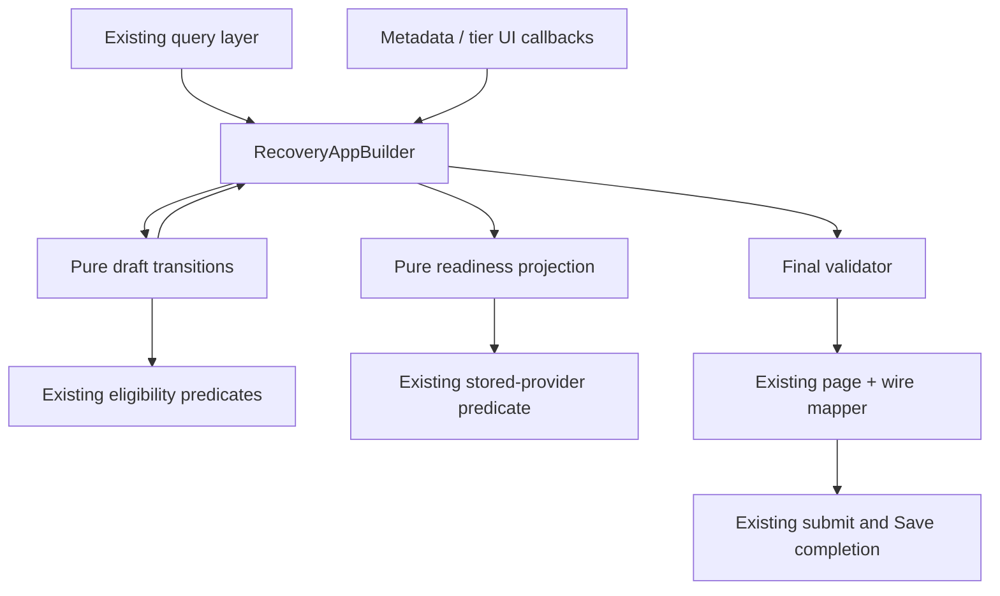

# Candidate 6: Recovery Application draft domain plan

## Executive summary and decision

**GO for focused extraction into two pure TypeScript modules.** Move draft transformations to `model/recoveryApplicationDraft.ts` and wizard/preliminary Save predicates to `model/recoveryApplicationDraftReadiness.ts`. Keep React state, confirmation presentation, query ownership, final validation, mapping, and Candidate 4 Save completion in their existing layers. A reducer or shared Group/Application engine would add lifecycle machinery that this draft does not need.

This is a planning artifact, not implementation approval. Implementation requires a separate request. Only this document and [the implementation checklist](recovery-application-draft-todo.md) are created by this task. No production/test changes, branch/worktree creation, commit, or push. The task-specific prohibition on committing overrides the repository's normal commit requirement. These explicit filenames override the planning skill's default `tasks/plan.md` and `tasks/todo.md`; existing unrelated plans remain untouched.

Inspected on 2026-10-26, branch `spike/ant-design-shell`, baseline HEAD `3db58bbe793216d1c4087c4ef9c838edf96312dd`. Initial tracked and untracked status was clean. Git emitted an inaccessible global ignore-file warning; repository status itself succeeded. Neither requested output existed. CodeGraph was present and used before code inspection; targeted reads filled omitted anonymous test bodies and unindexed re-exports. During planning, a concurrent commit advanced HEAD to `ae38904281d850b0b2681866ebaedceba219a67c`, changing only five files under `prototypes/technical-pages/`. A base-to-HEAD comparison confirmed no changes to the inspected Application/Group modules, ADR, agent rules, package/lockfile or Vitest configuration. This task did not create that commit. Recheck HEAD/worktree before implementation because other sessions may change them.

Inputs: the supplied Candidate 6 task; Candidate 6 in `C:/Users/polnikr/AppData/Local/Temp/architecture-review-recovery-cache-20261021-211912.html`; [ADR 0002](../docs/adr/0002-generated-react-query-api-layer.md). Current source takes precedence over historical review line numbers. ADR 0002's generated clients, selectors, keys, invalidation, and wire contracts remain untouched.

## Current architecture and responsibility map

Paths below are relative to `src/features/recovery-plans/recovery-applications/` unless explicitly rooted elsewhere. Line numbers refer to the inspected HEAD.

| Owner | Verified current responsibility | Destination |
| --- | --- | --- |
| `components/RecoveryAppBuilder.tsx:47-98` | Default tier/draft, cloning via mapper `cloneTier`, initial forced Push | Draft initializer; keep forced Push initialization in Builder |
| `components/RecoveryAppBuilder.tsx:101-151` | Generated provider/platform-provider/policy queries, Group hook, compatible/eligible lists, labels and VM options | Queries and display projections stay; domain independently reuses predicates at assignment boundary |
| `components/RecoveryAppBuilder.tsx:153-185` | Disabled guard, metadata filtering for locks, pending source patch, confirmation/detachment, dirty signals | Metadata planning and application move; pending proposal and dialog remain React state |
| `components/AppMetadataForm.tsx:46-95` | Controlled source/target, provider options/missing labels, source-type comparison and target reset | Options/rendering stay; reset decision moves to draft module |
| `components/RecoveryAppBuilder.tsx:187-288` | Group assignment/removal, VM inclusion/order/metadata, tier edit/add/delete/reorder | Named pure draft functions |
| `components/RecoveryAppBuilder.tsx:290-334` | Details, tiers, policy, orchestration, step progression and locked-provider Save readiness | Readiness projection |
| `components/RecoveryAppBuilder.tsx:336-348` | Final validator, translated alert, `onSave` | Stay in guarded UI callback |
| `components/TierCanvas.tsx:32-103,151` | Editing/drag state, sort by order, max order, last-tier delete presentation, reorder algorithm invocation | Stay; domain accepts existing valid callback results |
| `components/TierCard.tsx:77-111` | Normalize/check edit ID, trim/require description, VM option union | Stay as input validation/presentation; reuse utilities, no rule rewrite |
| `components/AddTierCard.tsx:20-38` | Normalize/check new ID, description, initial `maxOrder + 1` | Stay; domain applies this valid tier |
| `utils/tierUtils.ts` | Re-exports shared programmatic ID normalization/availability | Reuse unchanged |
| `utils/calculateTierReorder.ts:8-40` | Pure existing numeric-order algorithm | Reuse unchanged; no pointer/DOM state in model |
| `utils/recoveryGroupPlatform.ts:11-30` | Compute compatibility and publication/run eligibility | Single existing rule source, reused unchanged |
| `utils/eligibleProviders.ts:8-39` | Type, VMware role, credentials, IBM Power and Airflow eligibility | Reuse unchanged |
| `utils/validateRecoveryApplication.ts:24-44,47-173` | Stored provider verdict and final submission validation | Remain separate; readiness reuses only relevant predicates/verdict |
| `utils/recoveryApplicationFormMapper.ts:17-121` | Cloning, record-to-form, stored identity authority, wire conversion and missing-Group throw | Remain boundary mapper, not a transition engine |
| `pages/RecoveryApplicationBuilderPage.tsx:26-45`, `pages/RecoveryApplicationEditorPage.tsx:43-69,124-135` | Mapper invocation, submit facade, saved identity/Push props, Save lifecycle wiring | Unchanged |
| `hooks/useRecoveryApplicationSaveCompletion.ts:61-117` | Synchronous duplicate guard, pending state, navigation protection, failure unlock, result dialog/completion | Unchanged |

### Verified problems and important non-problems

- Source changes are one domain transaction, but target reset occurs in AppMetadataForm while confirmation/detachment occurs in Builder. Consumers must understand both to preserve cancellation.
- Assignment rechecks an eligible Group, whereas VM metadata lookup uses merely compatible Groups. Combining those lists would change rollback/unpublished stored-Group editing.
- Group removal and confirmed source change rebuild tiers with only `order` and `description`, dropping both `recovery_group` and optional top-level `vms`. This exact behavior must survive extraction.
- Dirty is a callback-event policy, not equality detection: duplicate VM selections and missing-tier/removal operations can return the same state yet notify dirty. Replacing it with `next !== previous` would change Back/Discard behavior.
- Details validity deliberately allows locked applications to advance while their stored provider verdict blocks Save. Readiness and final validation have different jobs.
- Zero-tier final validation currently succeeds with otherwise valid fields: `some(...)` over an empty Map is false. `validateRecoveryApplication.test.ts:20-34` already uses an empty Map in a successful case. Tier uniqueness and prevention of final-tier deletion are currently UI-enforced, not Builder-handler guarantees.
- `storedProvidersProblem` checks stored existence/type/role but **does not check credentials**. Create eligibility does. Do not add credential rejection to locked Edit as an extraction side effect.

## Alternatives and selected boundary

| Alternative | Benefit | Cost/risk | Decision |
| --- | --- | --- | --- |
| Keep current code | No migration risk | Source atomicity knowledge stays split; domain tests require React; no cohesive ownership | Reject for this focused improvement |
| Pure transitions plus readiness | Named operations, standalone tests, existing React/query lifecycle retained | Must preserve callback quirks and move component assertions to the correct owner | **Selected** |
| Complete reducer/lifecycle | One event entry point if complex lifecycle emerges | Large event union, query observations and dialog/save states become coupled; duplication of Candidate 4 | Reject; no demonstrated need |

The existing Group `recoveryGroupDraftLifecycle.ts` handles discovery identities, exclusions, topology and observation events. `resolveRecoveryGroupDraft.ts` merges derived discovery data; `recoveryGroupDraftReadiness.ts` projects readiness separately. Borrow the separation and explicit dirty result, not the reducer, discovery resolution or lifecycle type. Applications have no analogous reconciliation lifecycle. No cross-feature common draft engine.



## Exact proposed public TypeScript interfaces

These declarations are the selected contract, not files to implement during planning. Export the types from their owning module; no barrel, hook, generic reducer, deep-readonly framework or new state type is required. Existing form state keeps its `Map`. Arrays below use existing mutable array types so existing predicate signatures work unchanged; all inputs are observationally read-only by contract.

### `model/recoveryApplicationDraft.ts`

```typescript
import type { ProviderRecord } from '@/features/providers-connectors/providers/model/providerTypes'
import type { RecoveryGroup as AvailableRecoveryGroup } from '../../recovery-groups/model/recoveryGroupTypes'
import type {
  DraftRecoveryTier, LockedProviders, RecoveryApplicationFormState,
} from './recoveryApplicationTypes'

export type ApplicationMetadataPatch = Partial<Pick<RecoveryApplicationFormState,
  'fileName' | 'name' | 'description' | 'environment' | 'platform' | 'targetProviderId'
>>

export interface DraftContext {
  readonly providers: ProviderRecord[]
  readonly groups: AvailableRecoveryGroup[]
  readonly lockedProviders: LockedProviders | null
}

export interface DraftTransition {
  readonly draft: RecoveryApplicationFormState
  readonly notifyDirty: boolean
}

export interface SourceChangeProposal {
  // Snapshot only the scalar patch, not the draft or query data.
  // Always contains the proposed source; target reset is resolved at proposal time.
  readonly metadata: Readonly<ApplicationMetadataPatch & { platform: string }>
}

// 'unchanged' means that no scalar metadata value changes after filtering
// locked provider fields; it does NOT merely mean that source is unchanged.
// A changed name/description/etc. with the same source returns 'applied'.
export type SourceChangeDecision =
  | { readonly kind: 'unchanged'; readonly notifyDirty: boolean }
  | { readonly kind: 'applied'; readonly transition: DraftTransition }
  | { readonly kind: 'confirmationRequired'; readonly proposal: SourceChangeProposal }

export function createApplicationDraft(
  initialData?: RecoveryApplicationFormState,
): RecoveryApplicationFormState

// This is the one metadata entry point, including source and target changes.
export function planApplicationMetadataChange(
  draft: RecoveryApplicationFormState,
  update: ApplicationMetadataPatch,
  context: Pick<DraftContext, 'providers' | 'lockedProviders'>,
): SourceChangeDecision

export function applyConfirmedSourceChange(
  draft: RecoveryApplicationFormState,
  proposal: SourceChangeProposal,
  lockedProviders: LockedProviders | null,
): DraftTransition

export function assignRecoveryGroup(
  draft: RecoveryApplicationFormState, tierId: string, groupId: string,
  context: DraftContext,
): DraftTransition

export function removeRecoveryGroup(
  draft: RecoveryApplicationFormState, tierId: string,
): DraftTransition

export function selectRecoveryVm(
  draft: RecoveryApplicationFormState, tierId: string, vmName: string,
  selected: boolean, context: DraftContext,
): DraftTransition

export function addApplicationTier(
  draft: RecoveryApplicationFormState, tierId: string, tier: DraftRecoveryTier,
): DraftTransition

export function editApplicationTier(
  draft: RecoveryApplicationFormState, tierId: string, newTierId: string,
  updates: { tierDescription: string },
): DraftTransition

export function deleteApplicationTier(
  draft: RecoveryApplicationFormState, tierId: string,
): DraftTransition

export function applyApplicationTierOrder(
  draft: RecoveryApplicationFormState,
  reorderedTiers: Record<string, DraftRecoveryTier>,
): DraftTransition
```

Choose `planApplicationMetadataChange` instead of separate `planSourceChange`, target setter and metadata setter wrappers: the existing callback carries a metadata patch, and a combined patch must remain atomic. Do not expose both equivalent APIs. The function strips source/target keys under `LockedProviders`, compares source types itself, and owns the confirmation decision. When source types differ, the derived empty target takes precedence over a supplied target in that same patch. Scalar name/environment/etc. editing remains a simple merge inside that transaction. The `unchanged` decision is reserved for a patch that makes **no effective metadata value change after lock filtering**, not for an unchanged source alone. For example, `{ platform: currentSourceId, name: 'Updated' }` returns `applied` if the name changes. An identical-value patch or provider-only patch filtered by Edit locks may return `unchanged` while retaining the existing dirty notification for a received callback.

The four tier functions are public because Builder needs these transitions; they hide Map copying and nested preservation. Normalization/uniqueness helpers and the reorder algorithm remain existing utilities, not additional draft exports. Valid tier edits are supplied by TierCard/AddTierCard. Policy, orchestration-provider selection and Push retain the existing guarded scalar callback in Builder, narrowed to those three fields so it cannot bypass provider/tier operations. Preserve the disabled deployed-Push toggle and initialization that forces Push true. No settings reducer or wrapper solely for field assignment.

### `model/recoveryApplicationDraftReadiness.ts`

```typescript
import type { ProviderRecord } from '@/features/providers-connectors/providers/model/providerTypes'
import type { PlatformProviderRecord } from '@/features/platform-administration/platform-providers/model/platformProviderTypes'
import type { LockedProviders, RecoveryApplicationFormState } from './recoveryApplicationTypes'
import type { ValidationError } from '../utils/validateRecoveryApplication'

export interface DraftReadinessContext {
  readonly step: 1 | 2 | 3 | 4
  readonly providers: ProviderRecord[] | undefined
  readonly providersError: unknown
  readonly platformProviders: PlatformProviderRecord[]
  readonly areGroupsLoading: boolean
  readonly lockedProviders: LockedProviders | null
}

export interface DraftReadiness {
  readonly detailsValid: boolean
  readonly tiersValid: boolean
  readonly policySetValid: boolean
  readonly orchestrationValid: boolean
  readonly canContinue: boolean
  readonly canSave: boolean
  readonly providersLoaded: boolean
  readonly lockedProvidersError: ValidationError | null
}

export function getRecoveryApplicationDraftReadiness(
  draft: RecoveryApplicationFormState, context: DraftReadinessContext,
): DraftReadiness
```

`providers: undefined` must remain distinguishable from a loaded empty list. `providersError` preserves current truthiness semantics, including errors with cached data. Do not accept a Query object or import React/query APIs. Do not add Group arrays, policy-query status, `isFetching` or orchestration fetch status to readiness when current predicates do not use them. `canSave` remains preliminary and excludes the UI Save/initial-loading lock. Builder combines it with `isFormDisabled`; final validation remains the gate inside `handleSave`. Builder can retain numeric step state and narrow it at the call boundary, or type its 1-4 state without changing navigation behavior.

## Source/target transitions and pending confirmation

| Input/state | Draft result | Confirmation and dirty behavior |
| --- | --- | --- |
| Source unchanged, other metadata differs | Return `applied`; merge changed scalar fields while preserving source/target/Groups | No dialog; dirty once |
| Source unchanged, no effective metadata change | Return `unchanged` with the original draft | No dialog; received callback still notifies dirty |
| Changed source, no assigned Group | Apply patch immediately, including any required target reset | Dirty once |
| Changed source, at least one assigned Group | Return copied proposal only; current draft unchanged | No dirty until acceptance |
| Same-type source change with Groups | Confirm and detach **all** tier Groups, even VMware to VMware | Existing target retained, including an already-invalid target ID |
| Different source types | Set target to empty string as part of same proposal/application | Cancel preserves original target too |
| Accept proposal | Merge proposal into latest draft and detach Groups from latest tiers | Preserve tier IDs/descriptions/orders; dirty once |
| Cancel proposal | Clear UI pending proposal; no draft transition | No dirty; unrelated intervening edits survive |
| Target-only update | Update target, leave Groups/source alone | No confirmation; dirty once |
| Locked Edit metadata patch | Filter out source and target; retain other fields | Provider-only attempt has no effective change but retains current dirty notification policy |

For type comparison use current provider lookup exactly as AppMetadataForm does: `providers.find(...id)?.type` and strict inequality, including `undefined`. Both unknown types compare equal; known-to-unknown or unknown-to-known resets target. Do not infer types from provider ID strings or stored connection/platform names. Invalid target IDs are retained for display and rejected by readiness/final validation; same-type change is not an opportunity to auto-clear them.

**Descriptor rather than full draft snapshot:** a complete proposed draft would overwrite edits made after opening the dialog. The current implementation stores a partial patch and applies it to the latest `prev` state. The proposed descriptor preserves this. Freeze the reset decision in its scalar patch at proposal time, as today; a query refresh before acceptance must not silently recompute it. Current provider/Group eligibility is rechecked at readiness/final Save, not by turning confirmation into a new fetch lifecycle.

Merged metadata in a proposal is deferred as a unit. Later edits to keys outside that patch survive; overlapping keys are overwritten by the accepted patch, matching current spread order. Another source proposal replaces pending UI state. Accepted confirmation detaches Groups from every tier that exists at acceptance, including tiers added in between. Cancellation is UI state only. A change to provider authority while a dialog is pending must not unlock providers: the confirmation function filters source/target under the current lock and does not detach Groups in that case; this is a boundary defense for the explicit locked-provider contract, with a focused test. Ordinary editor mounting already supplies locks from the outset.

Do not add a revision counter, stale-proposal cancellation or automatic provider refresh. Those would change pending-confirmation semantics. Do not introduce a new `pendingSourceChange` Save predicate: today the modal handles ordinary interaction, and `canSave` itself does not include pending state. A pending Save disables the dialog and every draft callback. Failed Save unlocks the same draft/proposal rather than resetting initial data.

## Group, VM and tier invariants

### Groups

Resolve platform as `lockedProviders?.platform ?? providers.find(id === draft.platform)?.type`. Assignment must locate the Group in current context and call `isRecoveryGroupEligible`, which includes `isRecoveryGroupCompatible`: backup-system workload, matching supported compute type, `pushToOrchestrator === true`, nonblank string `airflowRunId`. Do not duplicate these rules or additionally require an exact Group provider ID match; current compatibility is by platform.

Copy Group ID, display name, description and VMs in `resources` order. **Initial assignment must preserve the exact spread precedence in the current Builder:** `{ name, order: index + 1, ...group.vmMetadataByName?.[name] }`. Consequently, metadata `order` overrides the computed index; a VM first in `resources` with metadata `{ order: 8 }` initially retains `order: 8`, **not** `order: 1`. Do not normalize that value during assignment. This differs intentionally from a subsequent real VM selection change, which reindexes all selected VMs sequentially starting at 1. Other hostname/IP/OS/CPU/memory/storage metadata follows the same existing spread behavior. Assignment creates draft-owned VM objects. Removal retains only tier `order` and `description`, keeping Map key/insertion position. Stored Groups are never repaired or removed merely because query results changed. Final validation rechecks existence, platform and publication against current Groups. Rollback/unpublish retains displayed configuration while blocking final submission.

### VMs

- Selecting an unselected name appends it to current selection; deselecting removes matching names and preserves relative order of survivors. Reindex all remaining VMs from 1 **only after a real selection change**; do not retroactively normalize `order` during initial Group assignment, where metadata `order` may override the index.
- Existing selected VM metadata remains from the draft, even if query metadata changes. A newly selected VM uses metadata from the current **compatible**, not necessarily published, Group.
- Missing Group data or an unknown VM name currently still permits a direct selection callback, adding `{ name, order }` without metadata. Preserve it; VM membership validation against live resources is separate hardening.
- Duplicate select or deselect of an absent name returns the current draft but still notifies dirty. No duplicate is appended. Removing then re-adding puts the VM at the end and uses then-current query metadata; metadata from the previously removed VM is not cached.
- No independent VM drag-sort feature exists here. VM order follows selection order; tier drag order is separate.

### Tiers

- Add: UI supplies normalized available ID, trimmed nonempty description and `maxOrder + 1`; domain stores a copied tier in a new Map.
- Rename/edit: preserve Group, selected VMs, metadata and numeric order; delete old key and set new key exactly as current Builder does. Renaming moves Map insertion position, while visual order remains numeric. Do not silently sort Map insertion order.
- Delete: existing UI disables deletion when only one tier remains. Deletion does not renumber remaining tiers. Last-tier rejection is a UI precondition in Candidate 6; extracting the callback must not silently change direct-callback semantics.
- ID normalization uses existing `slugify`/`isTierIdAvailable` (trim, lowercase, NFKD/accent removal, non-alphanumeric to underscore, trim underscores). Case/accent collisions remain rejected by controls before invoking callbacks.
- Reorder: TierCanvas keeps DOM event filtering, drag state and `calculateTierReorder`. The domain applies the returned record to the Map, preserving all content and algorithm-produced orders. No sorting rewrite or correction of existing algorithm edge cases in this task.

### Immutability and no-op contract

No exported function mutates its draft, Map, nested tiers, Group, VM arrays/objects, proposal, provider or Group query data. Each changed container is copied; unaffected subtrees may be structurally shared and must be treated as immutable by callers. Initializer reuses `cloneTier` for its existing nested Group/VM/volume cloning; it is not a promise of unlimited deep cloning. Optional top-level tier `vms` currently remains shared by `cloneTier`; the domain never mutates it. Deepening that clone can be proposed separately, not mixed into wire mapper work.

No-op identity is not dirty state. The explicit `notifyDirty` result preserves:

| Callback result | Draft identity/value | Dirty |
| --- | --- | --- |
| Disabled form/Save pending | No domain invocation or update | false |
| Source proposal/cancel | No draft change | false |
| Unknown/ineligible Group assignment | Same draft | false |
| Eligible Group but missing tier | Same draft | true |
| Remove missing Group/tier | Same draft | true |
| Missing tier/Group for VM, duplicate selection | Same draft | true |
| Edit missing tier | Same draft | true |
| Metadata effective no-op, including filtered provider-only patch | Value unchanged; identity not a public guarantee | true |
| Valid metadata, tier add/delete/reorder, accepted source | Current transformation | true |

React integration must never invoke dirty callbacks inside a functional state updater (which React may replay). Preserve event-level notifications outside the updater, using the documented result semantics; do not introduce an effect that marks every render dirty. Test with StrictMode or explicit call-count assertions where practical. The assignment guard can decide eligibility before scheduling the pure update, as today; callbacks and UI props must refresh with current query/lock state.

## Readiness versus final validation

Preserve these formulas, not a single merged Boolean:

| Projection | Exact rule |
| --- | --- |
| `detailsValid` | Valid file name and application name, trimmed description nonempty, and either locks exist or an eligible source plus eligible selected target |
| `tiersValid` | `tiers.size > 0` and every tier has a Group; does not check current Group publication/existence |
| `policySetValid` | Trimmed policy ID nonempty; does not require current policy list membership |
| `orchestrationValid` | Push off, or selected eligible Airflow provider (type AIRFLOW, credentials ok) |
| `canContinue` | Step 1: details; step 2: tiers; steps 3/4: policy, matching existing ternary |
| Step headers | Step 2 requires details; step 3 details+tiers; step 4 details+tiers+policy |
| `providersLoaded` | `Boolean(providers) && !providersError`; loaded empty array is a verdict, cached data plus fetch error is not |
| `lockedProvidersError` | Invoke `storedProvidersProblem` only with locks and loaded non-error data; otherwise null |
| `canSave` | details + tiers + policy + orchestration + not Groups loading + (unlocked or providers loaded without stored problem) |

Provider background fetching is not an independent blocker. Group errors/fetching, policy loading/errors and orchestration fetch errors are presented in UI but are not additional current preliminary Save flags when cached data satisfies the predicates. Preserve this nuanced behavior. For locked loading/error, show loading/retry rather than confirmed missing/incompatible warnings. Final validation is synchronous over the latest render's supplied data, not a forced server refresh at Save.

Final `validateRecoveryApplication` retains validation order and message keys: file/name/description/policy, stored identities or editable source/target, Push provider, missing assigned Groups, current Group compatibility/publication, IBM Power LPAR name pattern. Builder continues passing Groups, even an empty list, so missing stored Groups cannot be skipped accidentally. The validator's optional `groups` parameter currently skips those checks when omitted; don't change that API in this refactor.

### Explicitly deferred hardening

These are plausible safeguards, not part of behavior-preserving extraction: reject zero tiers in final validation; reject duplicate/unnormalized tier IDs and final-tier removal inside draft functions; validate VM names against Group resources; suppress dirty on effective no-ops; re-evaluate/cancel stale proposals; block all cached query errors; check credentials for locked providers; enforce deployed Push against synthetic direct callbacks; deep-clone legacy top-level tier VMs. UI protections must continue, but do not advertise them as universal domain guarantees. Any selected hardening needs its own requirements/tests and explicit approval. The only new defensive lock case in the proposed API is accepting a pending source proposal after authority becomes locked, as described above.

## Create/Edit, mapper and Candidate 4 compatibility

Create uses editable source/target IDs and existing credentials/type/role filters. VMware source currently means `role !== 'target'`, including absent role; target requires `role === 'target'`. IBM Power skips role restriction and permits the same HMC on both sides.

Edit uses `lockedProvidersOf` for every saved record, including missing/empty legacy provider IDs. UI names stored/missing providers and disables selects. Domain never resolves editable providers from stored platform names. Missing IDs block Save with legacy message, missing providers with side-specific messages, type/role mismatch with incompatibility. Stored IDs/platform remain authoritative in mapper even when draft fields differ. `lockPushToOrchestrator` continues forcing initialization and disabling the deployed Push toggle; no new synchronization effect resets a user's failed-Save draft.

Mapper remains responsible for record/form conversion, unknown environment preservation, email preservation (`undefined` -> null), stored provider authority, source ID to wire platform conversion, missing-Group rejection, and unchanged payload shape. No React imports, fetching or queries in model; no Orval/query-key/API adapter changes anywhere.

### Concrete payload oracle for F1 and F4

Existing mapper tests already assert `id: 'Finance'`, `policy_set_id: 'test_1_hour_ps'`, stored VMware source/target IDs and `notificationEmail: null`. Extend that fixture with the following exact expected **mapper output** (a planned characterization fixture, not a payload submitted during this task):

```json
{
  "id": "Finance",
  "policy_set_id": "test_1_hour_ps",
  "application": {
    "name": "Finance",
    "description": "Finance recovery",
    "environment": "prod",
    "platform": "VMWARE",
    "source_provider_id": "vmware-vcenter-01",
    "target_provider_id": "vmware-dr-01",
    "notificationEmail": "dr-team@example.test",
    "tiers": {
      "database": {
        "order": 1,
        "description": "Database server tier",
        "recovery_group": {
          "id": "database_group",
          "name": "Database Group",
          "description": "Database recovery group",
          "vms": [{ "name": "db-01", "order": 1, "hostname": "db-01.example.test", "ip_address": "192.0.2.10", "os": "Linux", "cpu": 8, "memory_gb": 32, "storage_gb": 200 }]
        }
      },
      "web": {
        "order": 2,
        "description": "Web server tier",
        "recovery_group": {
          "id": "web_group",
          "name": "Web Group",
          "description": "Web recovery group",
          "vms": [{ "name": "web-01", "order": 1 }]
        }
      }
    }
  }
}
```

Build the initial form/Group fixtures to produce exactly these values and assert the whole object, not partial matches. Pass this output as `data` in the unchanged page submission input, with `providerId: 'airflow-01'` and `pushToOrchestrator: true` for the pushed variant. Push/orchestration-provider selection must not become fields inside `application`; retain actual generated request construction in the existing facade. For local save, `pushToOrchestrator: false` leaves mapper output unchanged. For Edit, changed draft provider fields still serialize locked values above. For IBM Power, the expected three provider fields become `platform: 'IBM_POWER'` and source/target both `ibm-power-01`, with eligible Power Group/valid LPAR fixtures. Test email null and omitted source-record email as explicit null-output variants.

Candidate 4 controls remain independent: keep `isFormDisabled = isInitialLoading || isSaving`, disabled fieldset/inert region, early guards on every mutation callback and source confirmation, Save guard, page `beginSave()` synchronous ref protection, Back/Discard suppression while saving, failure unlocking without value loss, submitted identity captured for result dialog, and single successful navigation. Do not replace guarded callbacks with direct domain setters. A retained pre-Save DOM drag followed by a pending drop must be rejected. The completion hook and page production code require no changes.

## Characterization matrix and known coverage gaps

Abbreviations refer to exact files in the inventory below: B=Builder tests, M=Metadata tests, V=validator tests, W=mapper tests, C=Canvas tests, T=TierCard tests, A=AddTierCard tests, CP/EP=create/edit page tests, SI=Save integration. Existing coverage means assertions inspected in these files, not a claim that every permutation is covered.

| Area/scenarios | Existing evidence | Add before extraction / in domain tests |
| --- | --- | --- |
| Same, same-type, different-type source | M covers same/different type target behavior; B covers VMware-to-Power confirmation | B same-source dirty, second VMware source with assigned Groups, multi-tier acceptance (current test title says every tier but fixture has one); explicitly distinguish `{ platform: currentSourceId, name: 'Updated' }` (`applied`) from identical/filtered no-op patches (`unchanged`, dirty still notified) |
| Confirm/accept/cancel | B accept/cancel, no-Group immediate change, pending-Save dialog lock | Atomic target reset before/after cancel, intervening metadata/target/tier edits, provider refresh, replacement proposal, lock becoming active |
| Target retained/reset/invalid | M and V cover type filtering, clearing, unavailable/mismatched targets | Same-type source retains invalid target ID but readiness stays false; unknown provider comparison |
| Create/Edit | B, M, EP cover editable versus locked, stored IDs, missing and legacy | Provider-only direct patch lock and dirty policy, locked credentials differ from Create |
| Groups compatible/incompatible/unpublished/missing | B filters/blocks direct unpublished assignment; V rejects missing/mismatched/unpublished; B rollback/republish preserves draft | Missing tier with eligible Group dirty; full copy of Group display fields and all VM metadata |
| VM add/remove/duplicate/order | C/T selection callbacks; B stored metadata survives rollback | Full Builder callback characterization: all 8 VM fields, survivor metadata vs fresh metadata, re-add order, duplicates, unknown names, missing Group, absent tier; include first Group VM with metadata `order: 8` and assert **initial assignment retains 8**, then perform a real selection change and assert **sequential reindex from 1** |
| Tiers add/rename/delete/last/reorder | C/T/A validate callbacks, normalized collision, deletion disabled, Canvas drag behavior | Builder payload after rename/add/delete/reorder, numeric order vs Map insertion, UI final-tier protection, direct-handler quirks without new guards |
| Wizard each step | B four-step gating, target/policy requirement, preserved assignments | Table-driven pure projection for all steps, zero tiers, blank policy, stale nonempty policy, nonempty assigned but invalid stored Group |
| Final Save | V current Group/provider/Push/LPAR errors; B submit alerts | Explicit zero-tier validator acceptance paired with readiness rejection; current validation precedence |
| Providers loading/error/missing/credentials | B locked error/retry, missing/incompatible, Groups loading; M eligibility options | Undefined vs empty providers; cached data plus error; loading with retained data; credential change on Create vs locked Edit |
| IBM Power | B/M/V/W same HMC; V valid/invalid LPAR tables | Reuse existing tables; add transition metadata/order parity for Power |
| Legacy IDs | B/V/W missing source/target lock and errors | Confirm no platform-name fallback in new context |
| Push enabled/disabled/locked | B Airflow selection, Push conditional requirement, deployed toggle | Preserve disabled callback surface and initialization through extraction; keep direct-callback hardening separate |
| Mutation safety | B in-flight drag/drop, VM and metadata lock, dialog lock, failure unlock; CP/EP duplicate and navigation tests | Parameterize guarded callback families including metadata proposal, all tier/Group operations and VM selection; no dirty during lock |
| Mapper/wire/email | W exact wire shape, absent Group throw, email string/null/missing, stored identity; SI real request/response | One rich metadata/multiple-tier payload compared before/after; no unnecessary snapshots |
| Immutability | W detached nested VM state; B rollback initialData equality | Snapshot input value before every operation; frozen nested objects/query fixtures; Map entries unchanged (Object.freeze(Map) alone is insufficient) |

## F0-F4 implementation sequence

F0: review this decision, API, no-op table and deferred safeguards. Revalidate branch, HEAD and concurrent changes. **Checkpoint: human-approved module design before implementation.**

F1: add missing characterization tests to existing owners without production changes, in separate source/confirmation, VM/tier, and readiness/wire slices. Capture baseline payload values and callback counts. **Checkpoint: focused tests protect current behavior; unexplained divergence stops extraction.**

F2: implement initializer/metadata transaction, then Groups/VMs, then tiers, then readiness, each with focused pure unit tests. Keep existing production callers until their corresponding domain slice passes. **Checkpoint: domain is independently tested without React/DOM and without adapters.**

F3: migrate Builder source/target and confirmation together with AppMetadataForm's reset removal; then Group membership; VM selection; tiers; readiness. Run affected tests after each. Rehome the metadata-form reset tests to Builder/domain while retaining component tests for raw intent and controlled values. **Checkpoint: Builder delegates decisions and still protects every Save-time mutation.**

F4: focused regression inventory, typecheck/lint/diff validation, Playwright Create/Edit smoke, and wire-payload parity. **Checkpoint: acceptance evidence reviewed; no claim of browser completion without executing it.**

The detailed checklist splits each phase into tasks touching at most five files, with checkpoints after two or three tasks where phases are larger. Work sequentially on shared Builder and model files. Test fixtures or browser execution can be scheduled separately only after contracts stabilize; no concurrent edits to the same files and no agent delegation is needed for this planning task.

## Files to create, modify and leave unchanged

Future production creation:

- `src/features/recovery-plans/recovery-applications/model/recoveryApplicationDraft.ts`
- `src/features/recovery-plans/recovery-applications/model/recoveryApplicationDraftReadiness.ts`

Future test creation:

- `src/features/recovery-plans/recovery-applications/model/recoveryApplicationDraft.test.ts`
- `src/features/recovery-plans/recovery-applications/model/recoveryApplicationDraftReadiness.test.ts`

Future production modification (only these two are expected):

- `src/features/recovery-plans/recovery-applications/components/RecoveryAppBuilder.tsx`
- `src/features/recovery-plans/recovery-applications/components/AppMetadataForm.tsx`

Future characterization/integration test modifications:

- `src/features/recovery-plans/recovery-applications/components/RecoveryAppBuilder.test.tsx`
- `src/features/recovery-plans/recovery-applications/components/AppMetadataForm.test.tsx`
- `src/features/recovery-plans/recovery-applications/utils/validateRecoveryApplication.test.ts`
- `src/features/recovery-plans/recovery-applications/utils/recoveryApplicationFormMapper.test.ts`
- `src/features/recovery-plans/recovery-applications/pages/RecoveryApplicationSaveCompletion.integration.test.tsx`

Unchanged regression targets:

- `src/features/recovery-plans/recovery-applications/components/TierCanvas.test.tsx`
- `src/features/recovery-plans/recovery-applications/components/TierCard.test.tsx`
- `src/features/recovery-plans/recovery-applications/components/AddTierCard.test.tsx`
- `src/features/recovery-plans/recovery-applications/pages/RecoveryApplicationBuilderPage.test.tsx`
- `src/features/recovery-plans/recovery-applications/pages/RecoveryApplicationEditorPage.test.tsx`
- `src/features/recovery-plans/recovery-applications/hooks/useRecoveryApplicationSaveCompletion.test.tsx`

Keep TierCanvas/TierCard/AddTierCard production code, tier utilities/algorithm, validator production code, mapper production code, model types, pages, Save completion hook, query facades, Recovery Group modules and generated files unchanged. Tests may reveal a concrete need to revise this inventory; document it before expanding scope. Do not proactively rewrite these modules.

## Verification commands and planning baseline

Executed during this planning task:

```powershell
npm.cmd exec vitest run src/features/recovery-plans/recovery-applications/components/RecoveryAppBuilder.test.tsx src/features/recovery-plans/recovery-applications/components/AppMetadataForm.test.tsx src/features/recovery-plans/recovery-applications/utils/validateRecoveryApplication.test.ts src/features/recovery-plans/recovery-applications/utils/recoveryApplicationFormMapper.test.ts src/features/recovery-plans/recovery-applications/components/TierCanvas.test.tsx src/features/recovery-plans/recovery-applications/components/TierCard.test.tsx src/features/recovery-plans/recovery-applications/components/AddTierCard.test.tsx src/features/recovery-plans/recovery-applications/pages/RecoveryApplicationBuilderPage.test.tsx src/features/recovery-plans/recovery-applications/pages/RecoveryApplicationEditorPage.test.tsx src/features/recovery-plans/recovery-applications/pages/RecoveryApplicationSaveCompletion.integration.test.tsx
npm.cmd run typecheck
npm.cmd run lint
git diff --check
```

Baseline: focused Vitest **10 files / 213 tests passed**, Vitest 4.1.11, duration 86.21 s; typecheck and lint passed (exit 0). Final document-validation results are recorded below. These static-check results belong to the planning baseline, not a claim to have revalidated the unrelated concurrent prototype commit. No complete test suite, production build or browser smoke was run. The build script runs lint/typecheck/all tests/API checks and is deliberately not used for this focused task.

Future F4: rerun the exact ten-file command above and add the two new model test paths plus `src/features/recovery-plans/recovery-applications/hooks/useRecoveryApplicationSaveCompletion.test.tsx`. Run `npm.cmd run typecheck`, `npm.cmd run lint`, `git diff --check`. These broader static checks are explicitly required by the supplied task. Interim tasks use smaller explicit-file commands from the TODO. Avoid `npm test` and `npm run build` unless separately justified.

### Playwright browser smoke plan (not executed)

There is no Playwright dependency/script in package.json. Use an available Playwright-capable browser harness with the existing Vite app and deterministic test backend/network fixtures; do not silently install a new test framework or save production data. A persistent browser suite or new dependency requires a separate scope decision. The smoke can be executed through an external harness without adding repository files.

Seed VMware sources A/B, VMware target, IBM Power HMC, eligible Airflow, published Groups with rich VM metadata, a policy set, and saved editable/deployed/legacy records. Use an authenticated test session. Intercept the generated client's actual submit request, asserting parsed body and provider/Push request parameters against baseline fixtures. Record browser/harness version, test route, fixture identity, request bodies, console errors and screenshots/trace as evidence; redact credentials.

1. Create: fill metadata, source A/target; drag Groups onto two tiers, deselect/reselect VMs, rename/add/delete/reorder tiers; verify order and metadata in captured payload.
2. Propose A -> B (same type): cancel retains Groups/target, accept removes all Groups and retains target/tier identity/order. Then change to Power: cancel preserves everything, accept resets target, choose same HMC for both sides.
3. Verify wizard gates at each step, optional Push, Airflow credentials, valid/invalid LPAR feedback, unavailable current Group refusal on final Save.
4. Edit: locked stored providers and missing labels; provider fetch loading/error/retry versus confirmed missing/incompatible; legacy IDs remain blocked; deployed Push locked; stored email preserved.
5. Delay Save response: try metadata, VM/tier edits, drag/drop, pending source confirmation, duplicate Save, Back and Discard. Fail response; verify values and dirty guard remain, edits unlock, retry succeeds once. Check local success navigation and pushed result dialog/close navigation.
6. Compare exact Create/Edit wire payloads before/after refactor, including metadata and `notificationEmail`. A successful visual run alone is not payload parity evidence.

## Risks, rollback and acceptance

| Risk | Impact | Mitigation |
| --- | --- | --- |
| Full draft proposal overwrites later edits | High | Store scalar descriptor; merge into latest draft on accept |
| Moving reset leaves duplicate or no target clearing | High | Migrate metadata form and Builder contract in one slice; raw-intent component tests plus Builder assertions |
| Dirty equality optimization changes navigation | High | Explicit transition result; characterize no-op call counts |
| Save guard bypass via direct callback | High | Guard every callback before invoking domain; retain fieldset/inert and Candidate 4 regressions |
| Shared nested metadata mutation | High | Copy changed paths; compare original Map entries and frozen nested fixtures |
| Readiness rejects viewing or permits legacy Save | High | Keep provider-data verdict separate from details readiness and mapper authority |
| Eligibility broadened/narrowed inadvertently | High | Reuse predicates; distinguish compatible VM options from eligible assignment; preserve Edit credential asymmetry |
| Tier/reorder cleanup changes payload | Medium | Preserve algorithm and Map insertion behavior; rich exact payload fixture |
| Concurrent repository drift | Medium | Recheck HEAD/status and relevant code before each phase; never overwrite another session's work |

Rollback: keep characterization tests as evidence; revert only the affected integration slice if behavior diverges. Because wire/query/schema contracts never change, callers can return to the old callback implementation without a data migration. During F2 unused pure modules can remain unintegrated while faults are fixed; remove only files introduced by the aborted refactor if abandoning it. Never reset unrelated work or rewrite history. Any future commit workflow must follow the implementation request; no commits are made by this planning task.

Definition of done for implementation: both model modules own the named decisions, expose the selected typed contract and contain no React/network dependencies; Builder retains UI/lifecycle orchestration; AppMetadataForm emits provider intent without target-reset logic; characterized behavior and dirty signals match; locked identity and Push UI protection survive; rich wire payload/email parity is proved; final validation and readiness remain separate; all focused tests/static checks pass; executed browser results or explicit outstanding blockers are recorded; no unrelated/generated/Save-completion changes.

Acceptance of this plan: both requested documents exist, tasks and checkpoints are explicit and initially unchecked, exact files/commands/dependencies are present, scope and hardening are separated, and baseline claims are backed by executed checks. Human review/approval and all implementation phases remain pending. No open product question blocks writing this plan; the review should explicitly accept the compatibility quirks before implementation.

### Final planning validation record

- `git diff --check`: passed. Because these two files are untracked, a separate Node content assertion also checked their whitespace, code fences, conflict markers and unchecked task status.
- Node content/structure validation: passed for two documents, 16 sequential tasks (0-15), five phase checkpoints, required task fields, explicit backward dependencies, referenced full source paths (allowing the four planned new files), and two TypeScript declaration blocks parsed with the installed TypeScript compiler.
- Both proposed API declaration blocks also passed semantic type checking against the current repository types using virtual in-memory `.d.ts` files; no implementation or source files were written for this check.
- `git diff --exit-code -- src`: passed; no uncommitted production/test source changes.
- Branch/status assertion: `spike/ant-design-shell`, only the two requested documents untracked. Concurrent prototype-only HEAD advancement was inspected and left untouched.
- No implementation, production/test edits, browser execution, commit or push performed by this task. Human design approval and implementation remain pending.

## Implementation execution record

Implementation authorized by the user invoking executing-plans and explicitly selecting Recovery Application draft. Execution started on 2026-10-26 at HEAD `284e6acedd31158ad72eeb0050f7c675131a82e3` on `spike/ant-design-shell`. No Application/Group source drift since the planning baseline. The original planning-only and no-commit statements above describe the completed planning request; implementation follows AGENTS verification and atomic commit requirements. Work remains in the current checkout without new branches/worktrees or push.

F0 design review: accepted through the execution request, including the exact API, no-op dirty policy, descriptor-based confirmation, and deferred hardening. Implementation/test evidence will be appended as each phase completes.

F1 compatibility finding: assignment currently constructs `{ name, order: index + 1, ...vmMetadata }`; a metadata `order` value can override the initial numeric order while the VM array remains in resource order. Characterization protects that precedence (including metadata order 8). Selection changes subsequently reindex from 1. Changing metadata order precedence is deferred hardening, not part of this behavior-preserving extraction.
