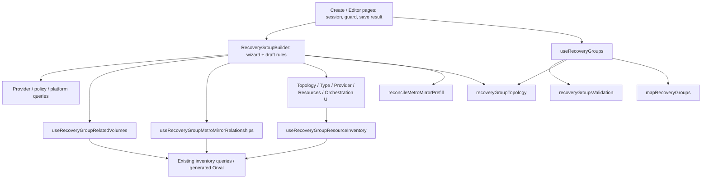

# Recovery Group Draft Lifecycle — implementačný plán

Dátum: 2026-10-22. Vetva pri analýze: `spike/ant-design-shell`.
Stav: používateľom spresnený a schválený plán bol implementovaný inline v F1–F4; výsledky a zvyšný ručný smoke sú v TODO.
Checklist: [recovery-group-draft-lifecycle-todo.md](recovery-group-draft-lifecycle-todo.md).

## 1. Executive summary a root cause

Architektonické zistenie kandidáta 3 sa potvrdilo zo zdroja: `RecoveryGroupBuilder.tsx` vlastní inicializáciu, resetové pravidlá, Discovery exclusions, skladanie efektívneho draftu, pôvod CG override, pruning aj readiness. React komponent tak musí poznať poradie doménových operácií. Problémom je rozptýlené vlastníctvo pravidiel, nie počet `useState` ani samotná veľkosť súboru.

Navrhuje sa lokálny čistý modul so štyrmi operáciami: inicializovať lifecycle, vykonať typovanú transition, odvodiť efektívny draft a vyhodnotiť readiness. Existujúce topology a Metro Mirror moduly sa komponujú. HTTP, cache, provider catalog, payload mapping, submit validácia a editor session ostávajú u dnešných vlastníkov. Nie je potrebný nový reducer framework, globálny store ani paralelná cache.

Refaktor má zachovať pozorovateľné správanie. Sedem otázok nižšie odlišuje preukázaný mechanizmus od hypotézy chyby. Zmeny obchodných pravidiel sa nemajú schovať do extrakcie. F1 najprv uzamkne aktuálny kontrakt; F2–F4 ho postupne prenesú za spoločný interface.

Pôvodný planning task vytvoril iba PLAN a TODO. Používateľ následne spresnil plán a schválil inline implementáciu F1–F4. Generated súbory a ostatné plány ostali bez zmien. Bez worktree, zmeny vetvy, stash/reset, commitu či pushu podľa konkrétneho zadania; všeobecné pravidlo AGENTS.md o commite tu má výslovnú výnimku.

## 2. Dôkazy a limity analýzy

Preverené cez CodeGraph a doplnené čítanie vynechaných blokov:

| Zdroj pod `src/features/recovery-plans/recovery-groups/` | Dôkaz / vlastníctvo |
|---|---|
| `components/RecoveryGroupBuilder.tsx:50,88,110–129` | create/edit seed, locks, dirty a metadata merge |
| `components/RecoveryGroupBuilder.tsx:178–237` | Discovery identity, tri reprezentácie, pruning, Metro prefill |
| `components/RecoveryGroupBuilder.tsx:238–287,327–344` | prefetch a readiness, source transition |
| `components/RecoveryGroupBuilder.tsx:385–513` | category/workload/provider/resource/related-volume transitions |
| `components/RecoveryGroupTopologyStep.tsx:40–68` | dnes časť resetov vytvára dieťa cez `Partial<RecoveryGroupDraft>` |
| `components/RecoveryGroupTypeStep.tsx` | edit konfigurácia je zamknutá; výber dostupného workloadu |
| `components/RecoveryGroupProviderStep.tsx` | zodpovedajúci typ a credential-valid providers |
| `components/RecoveryGroupResourcesStep.tsx:31–75` | remount pri zmene scope identity, metadata callback z efektu |
| `components/RecoveryGroupMetroMirrorFields.tsx`, `components/RecoveryGroupOrchestrationStep.tsx` | UI review/retry a manuálny CG, orchestration výber |
| `hooks/useRecoveryGroupRelatedVolumes.ts:15–43` | compute+VM queries, storage context, loading/resolved/error |
| `hooks/useRecoveryGroupMetroMirrorRelationships.ts:4–21` | Source+sorted unique names, response provider check, bez placeholderu |
| `hooks/useRecoveryGroupResourceInventory.ts:115–181` | provider scope, VMware server search, Power prefix, metadata |
| `utils/reconcileMetroMirrorPrefill.ts:4–29` | presný existujúci reconciliation algoritmus |
| `utils/recoveryGroupTopology.ts:6–24` | Source/partner/mode pravidlá |
| `utils/calculateRecoveryGroupStepIndices.ts` | 8 krokov VM / 7 volume flow |
| `hooks/useRecoveryGroups.ts:78–120` | final validation, osobitná legacy výnimka, submit a mapping |
| `helpers/mapRecoveryGroups.ts:24–40,152–180` | metadata a wire poradie, payload režimov |
| `pages/RecoveryGroupBuilderPage.tsx:41–64`, `pages/RecoveryGroupEditorPage.tsx:50–74,121–130` | dirty guard, save výsledok, navigácia, keyed edit initialization |

Preskúmané boli testy uvedené v testovacej matici (§8), ich pomenované scenáre a relevantné assertions. Page testy mockujú Builder: dokazujú page session kontrakt, nie skutočný Discovery lifecycle. Hook testy dokazujú transportnú identitu, samy osebe nedokazujú celý wizard.

Podklady: lokálny HTML report `C:/Users/polnikr/AppData/Local/Temp/architecture-review-recovery-cache-20261021-211912.html`, sekcia `group-draft`, a `tasks/architecture-boundaries-refactoring-plan.md`, Tasks 7, 8, 10. HTML zistenia boli overované oproti aktuálnym zdrojom, nie preberané ako potvrdené runtime chyby.

BE kontrakt znamená lokálne generovaný kontrakt: `src/generated/query/zod/getVdisksByVmParams.gen.ts:11–14` a `src/features/discovery-inventory/resources/model/inventoryQueries.ts:112–120`. Živý BE ani backend implementácia sa neoverovali. Bez browser reprodukcie a bez nových charakterizačných testov nie sú podozrenia na časovanie potvrdené chyby.

Počas plánovania bol vykonaný focused baseline príkaz z §8: **11 súborov / 173 testov prešlo**, exit 0 (Vitest 4.1.11, 76,03 s). Je to overenie existujúceho základu, nie implementácia F1 ani potvrdenie nových C1–C7 scenárov. Kompletný suite, build, typecheck a ESLint produkcie sa pri tomto dokumentačnom tasku nespúšťali; typecheck je povinný vo finále implementácie.

## 3. Aktuálna architektúra a dependency mapa



Cieľová zmena: medzi Builder a Top/Rec sa vloží lokálny lifecycle modul, ktorý prevezme pravidlá z Buildera a topology reset payloady z dieťaťa. Builder naďalej volá query hooks a renderuje kroky; posiela snapshots a doménové udalosti, nie vlastné resetové patche.

Žiadny nový cross-feature public export. Provider Catalog z architektonického plánu vlastní získanie dát a eligibility, lifecycle vlastní ich dopad na draft/readiness. Aktuálne typy sa môžu použiť cez úzky `Pick`; netreba v tomto tasku migrovať všetky cudzie modely. Existujúca topology funkcia už prijíma `ProviderRecord[]`; jej globálna migrácia patrí inému plánu.

Editor Session vlastní dirty guard, async save lifecycle, success modal a navigáciu. Lifecycle vráti informáciu, či prijatá používateľská udalosť oznamuje dirty; nevolá navigation ani mutations. Page session sa v kandidátovi 3 neextrahuje. Tasks 7/10 nie sú implementačné závislosti: kandidát 3 funguje na súčasnej vetve. Ak sa tieto práce prekrývajú, serializovať integráciu do Buildera a rebase mocky podľa aktuálneho vlastníka; nevytvárať druhý catalog/session.

## 4. State ownership a invarianty

### Tri reprezentácie

1. `draftState` je lokálny seed a používateľské/persistované hodnoty. Nie je to BE cache. Discovery sa do jeho `relatedVolumes` automaticky nekopíruje.
2. `selectionDraft` je raw stav + implicitný sole Airflow provider + stabilný union uložených/explicitných related volumes a momentálnych Discovery names po exclusions. Uložené/explicitné names majú prednosť aj poradie; Discovery pridáva unikátne nové names.
3. Efektívny `draft` navyše komponuje Existing prefill. Local vracia prázdny CG/mapu, Managed vracia uložené backend hodnoty na zobrazenie, Existing použije reconciliation. Tento draft ide do `onCreate`, nie raw stav.

Zmena projekcie nie je používateľská editácia: neoznačuje dirty a nepremení automatický prefill na override. Dnešný pruning je výnimka: technicky mení raw auxiliary mapu počas renderu bez dirty. Cieľ zachová jeho obsahový výsledok a presunie zápis do explicitnej, idempotentnej synchronizácie.

### Vlastníctvo polí a persistencia

| Polia | Pôvod / editácia | Čo odchádza do submit |
|---|---|---|
| `id`, `name`, `description` | user alebo edit seed; edit ID zamknuté; details normalizuje dnešná UI/validácia | id, trimované name/description, existujúca normalizácia ID |
| `sourceCategory`, `workloadType`, `resourceType` | user create; edit resource konfigurácia read-only; mapping určuje edit seed | rozhodujú konfiguráciu/mapping; nie tri rovnomenné wire polia |
| `providerId` | compute výber; pri volume odkazuje na FlashSystem Source | príslušné provider_id_vm/provider_id_volume |
| `relatedVolumeProviderId` | Source výber alebo BE; volume edit init ho nastaví z providerId | VM storage provider; pre volume používa mapper providerId |
| `resources` | user / uložený zoznam; poradie výberu sa nesortuje | VM alebo volume zoznam |
| `relatedVolumes` raw | BE seed + explicitné user pridania; bez VM provenance | efektívny union names; uloženie zahŕňa aj aktuálne odvodené Discovery volumes |
| Discovery names | BE query; nie raw user state | až ako súčasť efektívneho zoznamu |
| `consistencyGroupId`, auxiliary mapa | Existing CG: pri edit seede `H=Boolean(initialData?.consistencyGroupId?.trim())`; persistované `''` má H=false a umožní automatic prefill, manuálne vymazané `''` má H=true a prefill blokuje. Persistované auxiliary `{ VOL: '' }` je override podľa `Object.hasOwn`. | Existing trimuje iba vybrané names; Local zahodí, Managed nikdy neposiela backend-generated hodnoty |
| `vmMetadataByName` | BE record / inventory callback; nie ručný formulár | iba metadata pre vybrané VM cez mapper; nevybrané keys sa neserializujú |
| `policySetId` | user/BE | policy_set_id |
| `orchestrationProviderId` | user/BE alebo odvodený sole eligible Airflow | request parameter provider_id |
| `pushToOrchestrator` | user/BE | request parameter push_to_orchestrator |
| override flag, exclusions `{key,removed,all}`, previous selection key | iba lokálne lifecycle bookkeeping | nepersistujú sa a nevstupujú do BE payloadu |
| run ID, status, rawRecord, provider resolution | backend/mapping, mimo draft editácie | lifecycle ich nepremapováva ani neukladá |

Automatické prerezanie raw auxiliary overrides je prípustné až keď `discoverySettled = !isVm || (isResolved && !isLoading && !error)` a zmení sa sorted selected-volume key. Related hook používa `isLoading`, nie `isFetching`: background refetch s cache môže byť už settled. Nevymieňať tieto flagy pod zámienkou zjednotenia. Source reset a explicitné remove/clear smú čistiť okamžite aj bez úspechu Discovery.

Povinné invarianty:

- Legacy Local VM edit bez Source a volumes ostáva možný; nové create bez Source nesmie získať legacy výnimku.
- Existing CG: **persistované `''` má H=false**, preto automatický lookup smie vyplniť hodnotu; **manuálne vymazané `''` má H=true** a prefill nesmie prepísať túto hodnotu. Persistovaný prázdny auxiliary s existujúcim kľúčom má prednosť pred automatic lookupom. Nepovažovať všetky prázdne hodnoty za rovnaké overrides; loading/error nemaže uložené ani ručné korekcie.
- Managed údaje generuje backend; UI ich len zobrazuje, mapper ich znova neposiela.
- Pushed skupina je read-only. Managed po partial rollback s CG alebo neprázdnymi auxiliary hodnotami je read-only. Čistá Managed po úspešnom rollbacku je editovateľná, ale topology/source/mode ostávajú obmedzené existujúcou edit UI. **Read-only locks sú živé z aktuálneho `initialData` props**, nie zmrazené v initialize: rovnaká `group.id` môže bez remountu prejsť `unpushed↔pushed` alebo `clean Managed↔provisioned`. Udalosti aj disabled Save okamžite rešpektujú nový lock bez automatického resetu rozpracovaného draftu, kroku alebo dirty.
- Exclusions platia iba pre identitu `[storage Source, compute provider, sorted VM names]`; refetch rovnakej identity ich neruší. Zmena množiny VM dnes znamená novú identitu. `all` potláča automatic Discovery, nie explicitné následné pridanie.
- HTTP/query keys, provider VMware/Power scope, prefetch enablement a okamžitá navigácia zostanú nezmenené.
- Dirty sa oznamuje pri prijatej user editácii ako dnes; metadata, Discovery/prefill a pruning ho samy nenastavujú. Zachovať aj správanie opakovaného výberu rovnakého provideru.
- Nemeniť wire poradie/metadata v rámci tohto refaktoru. Mapper dnes robí `{name, order: index+1, ...metadata}`: uložené `metadata.order` môže vyhrať nad poradím indexu. To je existujúci detail vyžadujúci charakterizáciu, nie povolenie na opravu mappera.

## 5. Sedem otvorených oblastí — výsledok preverenia

| # | Súčasné správanie a dôkaz | Očakávaný invariant | Existujúce pokrytie | Chýbajúci test / riziko / rozhodnutie |
|---|---|---|---|---|
| Q1 | Odstránenie VM mení iba `resources`. Union ponechá raw `relatedVolumes`; uložený pôvodný disk teda zostane. Iba odvodený disk bez raw zápisu po odchode VM z Discovery zmizne. Raw zoznam nemá provenance VM. Builder :198,452–455. | Refaktor nesmie odhadnúť vlastníctvo uloženého disku a zmazať explicitný výber. | Builder :495 a parameterizovaný test :506 odlišujú manual od odvodených diskov. | C1: uložený DISK-A + remove VM-A + resolved Discovery bez DISK-A + submit. Vysoké riziko straty alebo nechceného uchovania disku. Automatické mazanie persistovaných diskov vyžaduje produktové rozhodnutie/provenance; bezpečný default je zachovať. |
| Q2 | `discoveryValid` kontroluje len !loading && !error, nie isResolved. Hook vypnutý mimo storage kroku vracia !loading aj pri nefetched VM; Local s platným Source môže prejsť priamo na Orchestration. Metro prefill má prísnejší settled gate, uložené kompletné údaje však môžu readiness splniť aj bez nového lookupu. | Nepremeniť vypnutý/unresolved stav na potvrdený úspech; súčasné povolenie preskočenia charakterizovať. | Builder :261,484 pokrýva loading pre lookup a error; prefetch testy pokrývajú neblokovanú navigáciu do Resources. | C2: direct step navigation s nevykonaným Discovery, Local/Existing/Managed a cached/necached. Vysoké riziko zmeny Save gatingu. Povinné čakanie na resolved je produktová zmena; bez rozhodnutia zachovať dnešné gates. |
| Q3 | Guardovaný zápis do vlastného state počas renderu nastaví previous key a niekedy mapu; nie je to bezpodmienečný nekonečný update. Guard settled chráni loading/error. :205–214. | Čistá projekcia bez zápisu, pruning iba aktuálnej identity a vybraných names; nesmie zmazať novší override. | Builder :277,506,540 a prefill tests overujú obsah, nie StrictMode/commit timing. | C3: StrictMode + pending/success/error/retry + remove/add pred flushom efektov. Stredné až vysoké riziko. Samotný render zápis nedokazuje runtime bug; presun je technické rozhodnutie, obsah sa zachová. |
| Q4 | Category/workload/provider patche čistia auxiliary/selection/metadata podľa vetvy, ale nechávajú CG aj `hasConsistencyOverride`. Len changeSource pri zmene topology/mode/Source vypína flag; topology dieťa navyše posiela prázdny CG/mapu. | Override provenance nesmie byť omylom prenesená extrakciou do inej kategórie ani potichu zmenená. | Builder :348 overuje zachovanie topology/Source, :277 reset Source, :673 mode roundtrip. | C4: manual CG → category/workload/provider zmena → nový výber → lookup. Stredné riziko starej CG. Reset CG pri zmene workloadu je otvorené produktové rozhodnutie; default zachovať aktuálne hodnoty/flag. |
| Q5 | Builder legacy gate vychádza z initialData a selectionDraft. Submit gate je v `useRecoveryGroups`, vychádza z aktuálne načítaného existujúceho záznamu a validated VM konfigurácie. Samotný validator dovoľuje optional Local storage bez kontextu create/edit. | Legitímny legacy edit musí fungovať, create nesmie obísť Source; payload validation a wizard readiness ostávajú rôzne. | Builder :752, validator :22, useRecoveryGroups :279 a :290. | C5: rovnaká matica create/edit, omitted/local topology, pridaný/odstránený Source, zmenený server record. Bežná legacy cesta je zhodná, algoritmy nie sú všeobecne ekvivalentné. Stredné riziko; zjednotenie netreba, zachovať samostatné kontexty. |
| Q6 | Metadata callback mergeuje celé inventory podľa mena; remove VM nemaže metadata, provider/workload zmena ich čistí. Neskorší callback nemá vlastný provider guard. Nevybrané keys sa do payloadu nedostanú; remove/readd rovnakého mena môže použiť uložené/staré hodnoty. `metadata.order` môže prekryť index mappera. | Zachovať payload aktuálne vybraných VM aj existujúce precedence; nezačať serializovať nevybrané keys. | Mapper :180,343; inventory mapping/scope testy; Builder provider reset :1066. | C6: remove/readd s/bez nového inventory, opačné uložené order, provider zmena počas requestu. Stredné riziko metadata/order; runtime kontaminácia nie je dokázaná. Zmena freshness alebo order precedence potrebuje samostatné rozhodnutie, default zachovať. |
| Q7 | Related HTTP key/request = compute provider + VM name; storage Source je UI enablement/exclusion context a vrátený echo údaj, nie HTTP filter. Generated kontrakt má iba vm_name/provider_id (vCenter alebo Power). MM lookup naopak posiela Source a unique sorted volumes. | Nepridať ibm_provider_id ani Source do generated disk query keys. Oddeliť UI identitu od transportnej. | Related hook :17 (neskorý starý compute), :36 retry; MM hook :17,35,55 (scope, late result, mismatch). | C7: zmena iba Source reutilizuje disk cache a resetuje exclusions; reorder VM nemení UI identity; Power parametre. Nízke až stredné riziko. Lokálny kontrakt je konzistentný; či má BE v budúcnosti filtrovať podľa Source je mimo rozsahu a neoverené na živom BE. |

**Dve dodatočné charakterizačné oblasti (bez zavádzania nových produktových Q):**

- **L1 — dynamické read-only locks:** pri editore s rovnakou `group.id` spraviť `rerender` s aktualizovaným `initialData` bez remountu; overiť `unpushed→pushed→unpushed` aj `clean Managed→provisioned→clean` vrátane disabled controls, Save, event admission a zachovania rozpracovaného draftu/step/dirty. Editor key je viazaný iba na `group.id`; aktuálny Builder locks prepočítava z props pri každom renderi. Je to charakterizácia existujúceho kontraktu, nie dôvod draft znova inicializovať.
- **CG1/CG2/CG3 — tri rozličné empty scenáre:** CG1: persistované `consistencyGroupId: ''` na edit seede má H=false, po validnom lookup môže prísť AUTO-CG. CG2: manuálne vymazaný CG má H=true, `''` zostáva aj po refetch a blokuje complete Existing. CG3: persistované `auxiliaryNamesByVolume: { VOL: '' }` má vlastný kľúč a automatický AUX ho neprebije. Overiť s reálnym prefill správaním, nie iba s izolovaným mockom `H`.

F1 nepridáva assertions na želané nové správanie namiesto dnešného. Ak reviewer schváli zmenu Q1/Q2/Q4/Q6, pripraviť samostatný behavior-change task až po baseline; tento TODO ju neimplementuje.

## 6. Úplná tabuľka transitions

Skratky: R=resources, V=raw relatedVolumes, A=raw auxiliaryNamesByVolume, C=raw consistencyGroupId, H=hasConsistencyOverride, M=metadata, X=exclusions. „Ostatné“ zahŕňa details/policy/orchestration, ak riadok nehovorí inak. Každý user event rešpektuje dnešné pushed/provisioned locks; metadata/observation sú systémové udalosti bez dirty. Testy C1–C7 sú nové charakterizácie v §5; U označuje nové unit prípady v transition testoch.

| Event | Preconditions | Updated fields | Reset fields | Preserved fields | Invariants / test |
|---|---|---|---|---|---|
| Initialize create | bez initialData | presný INITIAL_DRAFT | H=false, X empty, previous key=null; M zatiaľ undefined | žiadny legacy grant | U-init-create; Builder :334 |
| Initialize edit | initialData pri mount/remount | kópia R,V,A; M; volume Source=providerId; legacy topology='local'; BE orchestration defaults | X empty, previous=null; H=Boolean(trim saved C), takže prázdne persistované C nie je override | pôvodné hodnoty vrátane Managed zobrazenia | U-init-edit; CG1/CG2/CG3; Editor keyed mount, Builder :277,600,648 |
| Live authority update rovnakého ID | nové autoritatívne `initialData` props bez remountu | prepočet live lock contextu pre readiness/admission | **žiadny** reset raw draftu/H/X/step/dirty | používateľské hodnoty a legacy seed | L1 obojsmerný pushed/Managed lock, bez remountu |
| Details edit | editable; ID edit pravidlá v UI | povolené id/name/description | nič | ostatné | U-details; Builder :958; bez generic Partial escape hatch |
| Source change | Source sa skutočne líši | relatedVolumeProviderId; volume: aj providerId | V,A,C,H,X; volume aj R | VM compute/R/M; policy/topology/mode | U-source-vm/volume/same; Builder :473,277 |
| Topology change | create alebo Existing edit; clean Managed edit zamknuté UI | topology; metro→existing mode, local→null | C,A; H=false pri skutočnej zmene topology/mode | Source,R,V,M,X a ostatné | U-topology; Builder :382; TopologyStep tests |
| Metro mode change | iba create remote | existing/managed | C,A; H=false pri skutočnej zmene | Source,R,V,M,X | U-mode; Builder :673,624 |
| Category change | create | sourceCategory | workloadType/resourceType/providerId=null; R,V,M,A prázdne | Source/topology/mode/C/H/X/policy/orchestration | U-category; C4; Builder :348 |
| Workload select | create | category/workload/resourceType; volume provider=Source, VM provider zachovať iba rovnaký workload | pri inom workload R,V,M,A; pri rovnakom zachovať efektívne R,V a raw A | C/H/X/Source/topology/policy/orchestration | U-workload-same/different; C4. Zachovať dnešný detail: same-workload handler zapisuje efektívne V do raw V, ak je tak volaný. |
| Compute provider select | VM provider UI | providerId | pri inom provider R,V,M,A | pri rovnakom efektívne R,V a M; C/H/Source/topology/X/policy | U-provider-same/different; Builder :1066; C4 |
| Add resource (VM/volume) | ešte nie je v R | append do raw R | nič | M,V,C/H; A | U-add-duplicate/order; Builder resource flow |
| Remove VM | meno v R | R filter | nič ďalšie | V,M,A,C/H; X objekt ostáva, nová key ho prestane používať | U-remove-vm; C1,C6; Builder :506 |
| Remove volume resource | volume flow | R filter | A[name] | C/H, ostatné | U-remove-volume; Builder :540 |
| Add related volume | nie je v efektívnom V | append do raw V, nepromovať ostatné Discovery names | nič | X vrátane removed/all; C/H/A | U-related-add/readd; Builder :452,506 |
| Remove related volume | related storage UI | raw V filter; X=current identity, removed append; all zachovať iba rovnakej key | A[name] | C/H; ostatné V/R/M | U-related-remove; Builder :452 |
| Clear related selection | related storage UI | X={currentKey,removed:[],all:true} | V,A | C/H,R/M/Source/policy | U-clear/readd/refetch; Builder :452. Hlavné Resources dnes nemajú onClear; nepridávať nový UI flow. |
| Manual auxiliary edit | Existing input | A[name]=value vrátane '' | nič | C/H a ostatné A | U-aux-empty; Builder :300 parameterizovaný prefill test |
| Manual CG edit | Existing input | C=value; H=true aj pri '' | nič | A/ostatné | U-cg-empty; CG2 odlišné od CG1 persistovaného `''`; prefill testy |
| Policy / orchestration edits | editable | policySetId / orchestrationProviderId / pushToOrchestrator | nič | ostatné | U-policy/orchestration; Builder :419,691,879 |
| Inventory metadata available | callback; nemá user dirty | M={...currentM,...incoming} | nič | R a ostatné | U-metadata-merge; C6; zachovať existujúci merge kontrakt |
| Discovery observation / selection settled | aktuálna identity, settled a zmenený sorted volume key | previous selection key | A keys mimo aktuálne efektívneho selectedVolumes | raw V, C/H, R/M/X; novšie edits | U-observe-idempotent/latest; C3. Toto nahradí render-time pruning. |
| Derived projection / retry / pending / error | query snapshot | iba selection/effective výsledok a diagnostics | bez raw resetov | saved/manual inputs a X | C2,C3,C7; pure resolution tests; žiadny dirty |

Podmienky „same“ zachovať podľa dnešných handlerov; nevymeniť všetky resety za univerzálne „ak sa zmenila konfigurácia“. Zmenu topology/mode reset payloadu dnes vlastní dieťa: pri migrácii musí byť pravidlo iba v lifecycle, bez duplicitného resetu v UI.

## 7. Cieľový modul a konkrétny interface

Navrhované nové súbory pod `model/`:

- `recoveryGroupDraftLifecycle.ts`: jediný lokálny interface, typy a initialize/transition implementácia.
- `resolveRecoveryGroupDraft.ts`: interná pure kompozícia selection + existujúci reconciliation.
- `recoveryGroupDraftReadiness.ts`: interné pure readiness pravidlá.
- zodpovedajúce tri `.test.ts` súbory. Nevytvárať prázdne adapter triedy ani barrel pre každý helper.

```typescript
// Návrh kontraktu; nie produkčná implementácia.
initializeDraft(initialData?: RecoveryGroup): DraftLifecycle
transitionDraft(
  current: DraftLifecycle,
  event: DraftEvent,
  context: DraftObservation,
): { state: DraftLifecycle; notifyDirty: boolean }
resolveEffectiveDraft(
  state: DraftLifecycle,
  observation: DraftObservation,
): DraftResolution
getDraftReadiness(
  state: DraftLifecycle,
  resolution: DraftResolution,
  context: ReadinessContext,
): DraftReadiness
```

`DraftLifecycle` je modulom vlastnený readonly stav: raw draft, **stabilné initialize facts pre legacy/edit seed**, H, X a last-pruned key. **Aktuálny pushed/provisioned lock nesmie byť zmrazený v tomto stave.** Readiness aj `transitionDraft` admission dostanú live authority kontext z aktuálneho `initialData` pri každom renderi; pri rovnakej ID aktualizácia orchestration pushed alebo Managed backend CG/auxiliary ihneď mení readOnly, bez remountu, novej inicializácie raw draftu alebo dirty. UI disabled a event admission musia používať tú istú autoritatívnu hodnotu. Builder používa `resolution.selectionDraft` / `resolution.draft`; Initialize nesmie meniť initialData ani zdieľať mutable default arrays/maps medzi sessions.

`DraftEvent` je discriminated union konkrétnych udalostí z tabuľky: `detailsChanged` (iba details Pick), `sourceChanged`, `topologyChanged`, `metroModeChanged`, `categoryChanged`, `workloadSelected` (existujúci configuration typ), `providerSelected`, `resourceAdded`, `resourceRemoved`, `relatedVolumeAdded`, `relatedVolumeRemoved`, `relatedSelectionCleared`, `auxiliaryChanged`, `consistencyGroupChanged`, `policySelected`, `orchestrationProviderSelected`, `pushChanged`, `metadataAvailable`, `selectionObserved`. Žiadne verejné `patchDraft(Partial<...>)`. Mená/typy resource udalostí odlíšia hlavný a related zoznam.

`DraftObservation` prenáša read-only hodnoty z existujúcich hooks: related snapshot `{identity, flashcopyProviderId, discoveredVolumeNames, isLoading, isResolved, error}`, optional relationship output, sole eligible Airflow ID **a aktuálny úzky `editAuthority`/lock context z `initialData`**, nie zmrazený seed. `transitionDraft` aj readiness overujú ten istý živý lock; komponent ho iba odošle, neuchováva ako immutable lifecycle state. Identity sa tvorí z aktuálneho state v module; Builder ju iba pripojí ku snapshotu svojej aktuálnej hook invocation. Modul nevytvára query keys, HTTP request ani kópiu QueryClient cache.

`DraftResolution` vracia `selectionDraft`, konečný `draft` (s normalizovanými string/map/list defaults pre render), selectedVolumes, `discoveryIdentity`, `discoverySettled`, `relatedVolumeRequest: {computeProviderId,vmNames,sourceId}`, `relationshipLookup: {sourceId,names,enabled}` a existujúce prefill diagnostics (mismatch/unresolved). Readiness context nesie provider lookup/current status, eligible orchestration IDs, existujúce IDs/currentId, step a initial-loading informáciu. Nevyžaduje, aby caller vopred spočítal všetky domain booleans. Related snapshot je optional: bez neho resolver nevydáva žiadne nové Discovery names a nepovažuje VM Discovery za settled.

`DraftReadiness` explicitne obsahuje detailsValid, topologyValid, typeValid, providerValid, resourcesValid, storageValid, discoveryValid, policySetValid, orchestrationValid, canContinue, canCreate, **live autoritatívne locks (L1)** a readiness pre prefetch. `isSaving` naďalej disables button v UI; nemení domain draft.

### Poradie kompozície bez nového state frameworku

Builder načíta catalog. Prvé zavolanie resolvera bez query snapshotov poskytne relatedVolumeRequest a identity bez rozbaľovania interného raw state. Zavolá related hook s dnešným step enablement, druhým resolverom získa selection a Metro lookup plán, podľa neho zavolá existujúci Metro hook a tretia projekcia poskytne konečný draft. Druhá a tretia lacná čistá projekcia majú rovnaký selection výsledok; neobsahujú side effects. Tak netreba exportovať druhý selection algoritmus ani uložiť odvodené dáta do state. Topology gating lookupu sa v resolveri opiera o existujúcu topology funkciu a stav provider query; spoločné interné predicate použije aj readiness, nie reimplementovaná vetva v Builderi. Observation preto musí obsahovať aj tieto provider facts, zdieľané s ReadinessContext cez jeden pomenovaný typ. Trojpriechodová kompozícia je explicitný tradeoff malého interface; ak pri implementácii zhorší čitateľnosť alebo preukázateľne stojí priveľa, reviewer môže odsúhlasiť jeden pomenovaný selection vstupný krok, bez duplikácie pravidiel.

User dispatch používa funkčný React state update a počíta transition nad najnovším stavom; akcia `notifyDirty` sa nesmie vykonať vo vnútri updatera (StrictMode ho môže zavolať opakovane). Dirty callback vykonať v user handleri podľa rovnakého read-only admission pravidla; čisté transition testy overia návratový údaj. Pri implementácii zvoliť jeden jednoduchý lokálny dispatch adapter, bez generickej middleware vrstvy.

Efekt posiela `selectionObserved` iba po committed query snapshot zmene. Event nesie identity observation, nie hotový starý patch mapy. Funkčná transition overí identity voči latest state, znovu odvodí selectedVolumes z latest raw výberu a snapshotu, preverí settled/key a až potom prereže latest A. Idempotencia vráti rovnaký state pri opakovanom evente. Volume-only vetva je settled bez Discovery. Pending/error nezmazávajú saved A. Efekt nesmie rehydratovať starý raw snapshot po novšej user editácii.

Nezavádzať vlastné request revision counters preventívne: staré transport responses už izolujú existujúce query keys a Metro hook provider check. C3/C7 musia overiť integráciu s reálnym QueryClient. Ak sa dokáže medzera pri rovnakej identite, najprv reprodukčný test a konkrétny minimálny guard; bez globálneho event logu alebo ďalšej cache.

### Prečo ide o deep module

Caller sa naučí štyri operácie a sémantické udalosti. Nemusí poznať resetové poradie, union/exclusion precedence, ručný vs automatic CG, saved values počas loading ani legacy/Managed readiness podmienky. Po odstránení modulu by sa tieto previazané pravidlá vrátili do Buildera. Testy vykonávajú user/Discovery sekvencie cez rovnaký interface ako caller; netestujú súkromné settery. Samotný hook s dvadsiatimi setters alebo generic patch interface by túto vlastnosť nemal.

## 8. F1–F4 a konkrétna testovacia matica

Všetky cesty v nasledujúcej matici sú pod `src/features/recovery-plans/recovery-groups/`. Existujúce assertions sa počas F2–F4 neodstraňujú, nepreskakujú ani nenahrádzajú slabšími snapshots. Nové testy dopĺňajú vonkajší kontrakt.

| Fáza | Implementačné kroky a dotknuté súbory (unikátne v danej fáze) | Testovacia matica / exit criteria | Riziko |
|---|---|---|---|
| F1 | Doplniť charakterizácie vrátane L1 a CG1–CG3 v `components/RecoveryGroupBuilder.test.tsx`, `hooks/useRecoveryGroupRelatedVolumes.test.tsx`, `helpers/mapRecoveryGroups.test.ts`; nová `components/RecoveryGroupBuilder.discovery-lifecycle.test.tsx`; iba podľa potrebnej legacy matice `hooks/useRecoveryGroups.test.tsx`. 5 test súborov, 0 production. Rozdelenie T1–T3. | C1–C7, existujúci prefill/topology/validation baseline; explicitne oddeliť nedokázané bugy od regresií. Testy nových scenárov prejdú na nezmenenom production kóde; review potvrdí default zachovania správania. | stredné: nedostatočné mocks môžu simulovať nereálne poradie |
| F2 | Nový `model/recoveryGroupDraftLifecycle.ts`, `.test.ts`, zmena Buildera, TopologyStep a jeho `.test.tsx`. 5 súborov. Rozdelenie T4–T5. | Unit každý riadok transitions vrátane same/different, CG1 init H, no mutation, **L1 live lock admission bez reinitialize**, read-only; pôvodné Builder/TopologyStep tests aj F1 C1/C4/C6. Každý user reset má jedného vlastníka. | stredné až vysoké: same-workload/provider zapisuje effective výber |
| F3 | Nový `model/resolveRecoveryGroupDraft.ts`, `.test.ts`; zmena lifecycle a jeho testu, Buildera a F1 discovery integration súboru. 6 súborov v dvoch taskoch T6–T7 (max. 4/task). | C1/C3/C7, resolver union/order/exclusions/identity; **CG1: persistované prázdne CG povoľuje prefill, CG2: ručne prázdne CG ho blokuje, CG3: prázdny auxiliary s kľúčom ho blokuje**; Local/Existing/Managed; saved loading/error; late source/provider/VM responses; pruning iba aktuálneho úspechu. Existujúci `utils/reconcileMetroMirrorPrefill.test.ts` ostáva celý. | vysoké: asynchronous observation + najnovšia editácia |
| F4 | Nový `model/recoveryGroupDraftReadiness.ts`, `.test.ts`; zmena lifecycle interface a Buildera; doplnenie discovery integration a oboch page testov podľa potreby kontraktu. 7 súborov v T8–T9 (max. 5/task). | Všetky readiness flagy a gates v oboch step layouts, C2/C5, tri locks stavy **vrátane L1 aktualizácie pri rovnakom ID bez remountu**,  create/edit payload, dirty/cancel/save fail/success, prefetch neblokuje. Finálny typecheck + focused Vitest + ESLint + diff check. | vysoké: gating a page integrácia |

Počty sú odhad union súborov pre budúcu fázu, nie počet súborov zmenených teraz. Celkovo plán predpokladá 16 unikátnych implementačných/test súborov; scenáre navyše nesmú rozšíriť scope na BE, catalog/session či Snapshot Policy. Každý task v TODO má 1–5 súborov; F3/F4 sa preto nesmú vykonať naraz ako jeden veľký patch.

### Test inventory a verifikačné skupiny

PowerShell príkazy sú spúšťané z koreňa repozitára. Nasledujúce premenné sú iba skratkou pre explicitné zoznamy súborov, nie glob pre celú feature.

```powershell
$rgRoot = 'src/features/recovery-plans/recovery-groups'
$baselineTests = @(
  "$rgRoot/components/RecoveryGroupBuilder.test.tsx",
  "$rgRoot/components/RecoveryGroupBuilder.prefetch.test.tsx",
  "$rgRoot/hooks/useRecoveryGroups.test.tsx",
  "$rgRoot/api/recoveryGroupsValidation.test.ts",
  "$rgRoot/utils/reconcileMetroMirrorPrefill.test.ts",
  "$rgRoot/utils/recoveryGroupTopology.test.ts",
  "$rgRoot/hooks/useRecoveryGroupRelatedVolumes.test.tsx",
  "$rgRoot/hooks/useRecoveryGroupMetroMirrorRelationships.test.tsx",
  "$rgRoot/pages/RecoveryGroupBuilderPage.test.tsx",
  "$rgRoot/pages/RecoveryGroupEditorPage.test.tsx",
  "$rgRoot/helpers/mapRecoveryGroups.test.ts"
)
node node_modules/vitest/vitest.mjs run @baselineTests
```

| Skupina | Súbory navyše k relevantnému baseline | Čo dokazuje |
|---|---|---|
| F1 | `components/RecoveryGroupBuilder.discovery-lifecycle.test.tsx` | ovládaný QueryClient/fetch, C1–C7 ako vyššie; page mocks sa nepoužijú na dokazovanie Discovery |
| F2 | `model/recoveryGroupDraftLifecycle.test.ts`, `components/RecoveryGroupTopologyStep.test.tsx` | kompletné transition eventy a UI event mapping |
| F3 | `model/resolveRecoveryGroupDraft.test.ts` + F1 integration + lifecycle test | projekcie, explicit vs persisted vs automatic precedence, pruning |
| F4 | `model/recoveryGroupDraftReadiness.test.ts`; `hooks/useRecoveryGroupResourceInventory.test.tsx`, `utils/calculateRecoveryGroupStepIndices.test.ts` ako existujúce scope/layout regresie | readiness pravdivostná matica + provider scope + navigačné indexy |

**Finálna wizard-step regresná skupina (päť existujúcich testovacích súborov):**

```powershell
$wizardStepTests = @(
  "$rgRoot/components/RecoveryGroupTypeStep.test.tsx",
  "$rgRoot/components/RecoveryGroupProviderStep.test.tsx",
  "$rgRoot/components/RecoveryGroupResourcesStep.test.tsx",
  "$rgRoot/components/RecoveryGroupMetroMirrorFields.test.tsx",
  "$rgRoot/components/RecoveryGroupOrchestrationStep.test.tsx"
)
node node_modules/vitest/vitest.mjs run @wizardStepTests
```

Do **kombinovanej F4 akceptácie pridať všetkých päť suites** popri 11 pôvodných baseline súboroch a nových F1–F4 testoch; nič nenahrádzať. Chránia event kontrakty, disabled/read-only UI, resource selection, Metro CG/auxiliary a orchestration.

F1 checkpoint spustí baseline + F1 integration. F2 checkpoint pridá F2 skupinu, F3 checkpoint pridá F3 skupinu, F4 finále baseline + F1–F4 + päť wizard-step suites. Pri jednotlivých taskoch stačí focused podmnožina z TODO; checkpoint kombinuje predchádzajúce dotknuté kontrakty.

Riadený async scenár (bez náhodných sleepov):

1. VM Discovery pending; uložená A/C ostávajú, user zadá vlastný CG alebo zmení explicitný volume selection.
2. Dokončiť aktuálny deferred request, skontrolovať union a user precedence; automatic hodnoty sa nestanú raw overrides.
3. Spustiť refetch, počas neho user zmení auxiliary na `''`, potom na manuálnu hodnotu; dokončiť refetch s odlišným automatic CG/A.
4. Submit odovzdá najnovší override. Opakovať s remove/clear/readd, zmenou Source/compute provider/VM identity, úspechom aj chybou/retry a so StrictMode.
5. Pri rovnakej identite refetch zachová exclusions; po zmene identity sa správanie riadi dnešnou key semantikou. Opačné poradie dokončenia starého a nového requestu nesmie kontaminovať aktuálnu projekciu.

Readiness baseline: details=id available+name+description; type=tri vybrané polia; provider=matching healthy provider podľa create/edit scope; topology=providers nie loading/fetching/error + topology helper; resources=R.length>0 && (VM || storageValid); storage=Local alebo nonempty volumes a Managed/úplný Existing CG+A; discovery=neVM alebo !loading&&!error; policy=ID; orchestration=vybrané alebo sole eligible Airflow ID prítomné medzi eligible. `baseValid`, `downstreamValid`, canContinue podľa krokov a canCreate podľa dnešného Builder :337–344. Related-storage krok má dnešný fallback downstreamValid. CanCreate nevyžaduje push toggle=true. Žiadne doplnené čakanie na Metro lookup pri úplnom manuálnom vstupe.

Final submit naďalej zvlášť overuje normalizované resources, duplicity, konfiguráciu, topology a dostupnosť provider dát v mutation hooku. Nepridávať do pure payload validácie wizard step ani query loading flags.

Finálna validácia budúcej implementácie:

```powershell
npm.cmd run typecheck
# Focused Vitest: baseline + konkrétne nové/extra testy z matice, explicitné paths.
# ESLint: explicitný zoznam iba zmenených .ts/.tsx súborov daného tasku.
npm.cmd exec -- eslint <explicit-changed-ts-tsx-paths> --max-warnings 0
git diff --check
```

Placeholder ESLint sa pri vykonaní nahradí skutočnými cestami; TODO uvádza presné task scopes. `npm.cmd run build` sa nepoužije ako focused check: v tomto repozitári zahŕňa celý lint/test/api pipeline. Kompletný suite ani production build sa neplánujú bez novej odôvodnenej požiadavky.

## 9. Akceptácia, riziká a rollback

Akceptácia celého refaktoru: všetky scenáre matice sú zelené, každá transition a readiness politika má vlastníka v lifecycle, Builder neobsahuje resetové patche/union/prefill/pruning pravidlá; zostáva wizard a query/prefetch orchestrátor. Existujúce assertions, payloady, query keys, invalidácia a UI flows sú zachované. Generated ani backend súbory sa nemenia. Počet riadkov Buildera nie je meradlo úspechu.

| Riziko | Mitigácia / regresia |
|---|---|
| Uložený disk nesprávne považovaný za odvodený | C1; zachovať raw provenance hranicu bez odhadu podľa aktuálnej Discovery |
| Pri prechode kategorii alebo provideru sa zmení CG policy | C4; rozhodnúť osobitne, počas extrakcie kopírovať aktuálnu transition |
| Cleanup efekt prepíše novší user vstup | selectionObserved identity + latest functional state; C3 StrictMode/deferred testy |
| Prenos automatic hodnôt do raw state z nich urobí overrides | nikdy nepersistovať celý effective draft do state; CG1–CG3 chránia odlišné CG/auxiliary empty správanie; výnimky same-workload/provider charakterizovať |
| Prísnejšie readiness pokazí legacy alebo direct step navigation | C2/C5, oddelené submit validation, current gating truth table |
| Strata Managed partial rollback lock alebo jeho zmrazenie v initialize | Builder :580/600/648 + L1 same-ID rerender oboma smermi, live lock/admission matica a reálne disabled Save; no remount |
| Konflikt s catalog/editor-session/Snapshot Policy prácou | nemeniť cudzie tasks; skontrolovať status pred každým budúcim patchom; integráciu spoločného Buildera vykonať postupne |
| Overengineering | žiadny generic event bus, global store, custom query revision/cache, shared Group/Application lifecycle ani generický readiness engine; štyri operácie a interné pure funkcie |

Rollback budúcej implementácie: F1 je samostatná testovacia poistka. F2–F4 sa integrujú po malých reviewovateľných zmenách s checkpointmi. Pri regresii najprv revert poslednej integračnej zmeny spolu s jej novými imports; zachovať F1 charakterizácie a existujúce helpers. Reverty F4→F3→F2 rešpektujú závislosti; nevytvárať runtime feature flag pre dva paralelné draft algoritmy. Teraz sa nevykonáva commit ani revert/reset; spôsob uloženia budúcich implementačných zmien určí implementačné zadanie a pravidlá repozitára.

## 10. Review rozhodnutia pred implementáciou

- Schváliť behavior-preserving rozsah a interface. Q1 automatické mazanie persistovaných diskov, Q2 povinné Discovery pred Save, Q4 reset CG a Q6 freshness/order sa nesmú uzavrieť odhadom. Bez produktového rozhodnutia F1 zaznamená dnešné správanie a F2–F4 ho zachovajú.
- Schváliť L1: živé locks z aktuálneho `initialData` aj pri rovnakej ID bez remountu či resetu draftu; CG1–CG3: persistované CG `''` nie je override, ručne vymazané CG `''` je override a uložený auxiliary key s `''` je override.
- Odsúhlasiť technický presun pruning do idempotentného observation eventu; tests musia preukázať rovnaký výsledok bez render zápisu.
- Pri prípadnej zmene payload order určiť, či má vyhrať uložené `metadata.order` alebo index výberu; mapper sa v tomto pláne neopravuje.
- Potvrdiť poradie integračnej práce, ak sa súčasne začne Provider Catalog / Editor Session. Nie je potrebné čakať na ich implementáciu, len neprepisovať ich vlastníctvo.

Používateľ po spresnení PLAN/TODO schválil inline vykonanie. Implementácia zachovala dnešné produktové pravidlá Q1/Q2/Q4/Q6.

## 11. Realizovaný interface a overenie

- `model/recoveryGroupDraftLifecycle.ts` exportuje initializeDraft, transitionDraft, resolveEffectiveDraft a getDraftReadiness. Tri čisté produkčné súbory majú tri unit suites. Builder používa sémantické udalosti a query snapshots bez reset/union/prefill/readiness policy.
- DraftLifecycle neuchováva lock snapshot; editAuthority je živý vstup admission aj readiness. CG1–CG3 majú samostatné charakterizácie. Same-provider/workload effective selection aj metadata.order precedence ostali zachované.
- Trojpriechodová pure kompozícia zostala podľa návrhu. Resolver navyše vracia selectionObservation event iba pri potrebnom settled cleanup; Builder nepočíta sorted selection key ani neotvára raw state. Committed efekt event asynchrónne naplánuje a pri cleanup ho zruší. Transition prepočíta selection nad latest raw state; event nenesie starú auxiliary mapu.
- Zmenených je 16 implementačných/test súborov a dva plánovacie dokumenty. Produkčný mapping, submit validácia, Discovery HTTP hooks, generated kontrakty, query keys a invalidácia sa nemenia.
- Finálne overenie: 309/309 focused testov v 23 súboroch, typecheck, ESLint 16 zmenených TS/TSX súborov a diff check prešli. Kompletný suite/build sa nespúšťal. Ručný browser smoke je otvorený pre nedostupný browser/DevTools runtime; detaily sú v TODO.
